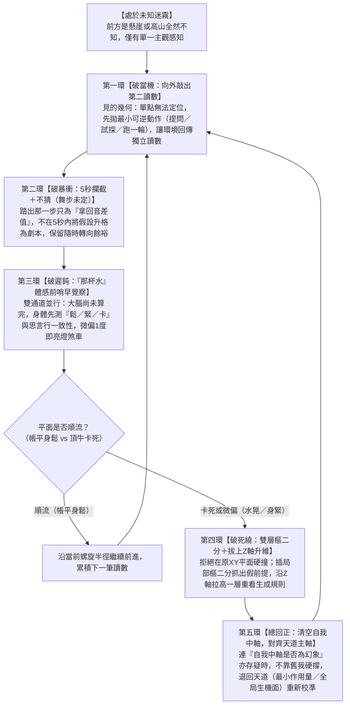

> 本檔為作者確認稿的 GitHub 去識別化公開整理版。正文、動態導航模型與結構限制保留；案例姓名、私人經歷及來源層細節已去識別化；私人來源改接本庫文件或[來源狀態](../SOURCE_STATUS.md)。原定稿另存不變。

# 《生命導航學》體系發展參照地圖

**版本：** v0.10（母願景生成鏈、自己的中軸、動態定位與中介機轉整合定稿版）  
**日期：** 2026-11-10  
**主要來源：** 《生命導航學_奠基文件_v8.76》（含 v8.75 基線）、《AI版奠基文件_零至十四部完整閱讀稿_v0.5》、《實驗脈絡重力帳（2026-11-10 E13 收束定稿）》、2026-10-26 至 2026-11-10 跨框協作對話（含《2026_10_ChatGPT對話錄_Vol31》P5272–5517、《2026_10_ChatGPT對話錄_Vol32》P4840–5041、《2026_10_Gemini對話錄_Vol49》、Argon v0.6/v0.9 及 Antigravity 五環盲飛動力鏈拆解）  
**直接使用者：** 作者本人與跨框協作 AI（ChatGPT / Claude / Gemini / Antigravity）  
**文件定位：** 本檔是承接《生命導航學_奠基文件》（母理論心法與零件庫）與各領域實作（第一本書稿、日常伴人、職場專案、AI 治理實驗）之間的**「樞（中介機轉翻譯地圖）」**。它不取代母奠基文件或寫作工作版，而是回答：**一套從作者四十七年求生實作中長出來的內化能力，究竟如何在「前方一片迷霧的未知常態」中，以「自己的中軸」為重心、以「動態定位」為感應、以「中介層機制」為疏導，一步步動態運轉而不出軌，並轉譯為他人與 AI「進得來、用得上、受現實檢驗、傳得下去」的活體體系。**

---

## 零、動筆與調用前的一句話定位

- **這份文件要解決什麼宿命難題：** 歷代版本（`v0.1`～`v0.8`）之所以總讓作者感到「顧此失彼、有的地方動態、有的地方又變回靜態」，是因為：
  1. 若只按概念切面分類（如早期 `v0.5.1` 的七切面或 `v0.7`/`v0.8` 的教案分類帳），就會把一匹奔跑中的馬切成靜態標本，丟失作者在未知中求生的第一人稱動態脈搏；
  2. 若只寫動態場感而未綁定嚴格的幾何與型別邊界（如 `v0.6` 局部將天道混同於方向、或後半段退回七切面並列），又會失去結構咬合與防呆精度；
  3. 若只談未知迷霧中的五環反應動作，而丟失了**母願景生成鏈的靈魂**與**「動態定位 ＋ 中介層機轉」的底層底盤**，整套體系就會失去其貫穿縱向與橫向的根本基石。
- **本版（`v0.10`）的整合解方：** 以**「母願景活體生成鏈」**為靈魂方向，以**「自己的中軸 ＋ 3D 螺旋動態定位」**為底層脊椎與「學習如何學習得以發生」的通用底盤，以**「中介層機制」**為最小作用量落地與修復動線，以**「未知迷霧中的五環動態導航鏈（破當機 → 破暴衝 → 早覺察 → 破死繞 → 總回正）」**作為連續動詞脈搏，正面拆解 `Vol31`「武學高人在樹林裡隨手撿起樹枝當武器」背後的真實運作機制，將 **Argon（`v0.6`/`v0.9`）的活體動態場感**與 **ChatGPT（`v0.7`／`v0.8`）的型別嚴謹度及三條路分際**徹底焊為一體。

---

## 一、母願景生成鏈與體系總定位

### 1.1 母願景：一條從個體自覺通向全人類生機展開的「活體因果生成鏈」

《生命導航學》的母願景不是一句口號，而是一條具有深刻因果推力與實踐方向的**活體生成鏈**：

```
【母願景活體因果生成鏈】
以「認識完整的自己」為根基
  └──► 讓全人類看見「小我心智代碼」的存在
        └──► 讓人類依「自由意志」發揮潛能
              └──► 讓生命力朝向「富生機面」流轉
```

1. **以「認識完整的自己」為根基：**  
   這裡的「自己」是全息展開的——包含人生各領域、每個當下，從裡到外（細胞、身體、情緒、小我、中軸）、不同尺度與層次中的真實狀態與關係。身體、心智、他人、環境與宇宙觀，不是認識自己之外的附加題，而是理解完整自己時不可任意割裂的面向。
2. **讓全人類看見「小我心智代碼」的存在：**  
   痛苦不是原罪，而是生命體在演化中為了求生而長出的「恐懼驅動」，被過度外溢到整個生命系統。小我心智在未知中因恐懼失控，於 3～5 秒內將幻象當作現實，編織出自我防衛與控制劇本。唯有清楚照見這套代碼的運作機轉，人才能從「以為心智即我」的沉睡中醒來。
3. **讓人類依「自由意志」發揮潛能（心智主權獨立戰爭）：**  
   這是一場奪回大腦與心智主權的獨立戰爭。人不再將判斷權與生成權外包給小我恐懼、外在權威或工具；把生命力放回主位，大腦退回工具輔位，人才能依自由意志在客觀邊界內選擇方向，從被動防禦轉向主動創造，使被恐懼凍結的潛能充分甦醒。
4. **讓生命力朝向「富生機面」流轉：**  
   宇宙雖有死寂與生機的自然循環，但人世間因恐懼創造的死寂、內耗與暴力已經太多。生命導航學的核心願景，就是讓人天生的想像力與生命力，減少空轉於心智幻象，多一點改用到創造性的潛能實踐，如恆星核聚變般自發光熱，推動全局生命力順暢流轉。

---

### 1.2 體系總定位：無形層（底層作用）與有形層（現實驗收）互為表裡

```
【無形層（底層規律與內在作用）】            【有形層（外顯方法與現實落點）】
  一元／二元宇宙觀、最小化母原理              各領域定位操作、中介層動線設計
  開合樞、自己的中軸、那杯水體感     ◄───►    生活除錯、職場會勘、伴人回正
  未知迷霧中的五環即時導航閉環                寫書（原礦回溯）、AI 治理沙盒實證
```

- **無形層不是脫離現實的玄談，有形層也不是死背步驟的SOP：** 每一次有形層的提問、微動作與動線調整，背後都是無形層定位與最小作用量的即時運算；而無形層的每一次校準讀數，都必須透過有形層與外部現實的真實摩擦（身體鬆緊、事件後續、沙盒客觀紀錄）來驗收。

---

### 1.3 體系雙翼：「前半（除錯復位學）」與「後半（引擎生成學）」在同一螺旋上即時咬合

| 體系雙翼 | 核心處理問題 | 主要運作方向 | 兩者如何在未知中即時咬合 |
| :--- | :--- | :--- | :--- |
| **前半：生命流除錯復位學**<br>（清堵塞、止損、回正） | 當人或系統卡在心智幻象、手段吞沒目的、假前提或關係錯位時，如何辨識失真、溯源拆結、回收主權、讓生命力恢復流動。 | **由果溯因（往回拆）：**<br>從痛點／斷點出發，沿活體生成鏈往上一層回溯，找到錯位節點並復位。 | 當行動者在**後半（未知中往前生成下一步）**因迷霧或外力衝擊而出現微偏時，系統在毫秒至數秒間自動觸發**前半（那杯水警報 → 雙層樞拆解假前提 → 退回中軸復位）**，使探索不致演變為走火入魔。 |
| **後半：引擎生成學**<br>（長出讀取端、煞車與自我導航） | 普通人或協作系統如何從「靠外力除錯」，逐步長出自己的**讀取端（見的幾何）、身體煞車（那杯水）、中軸比對器與動態生成能力**，成為自己的 GPS。 | **由未知生路（往前走）：**<br>在沒有現成劇本的迷霧中，邊走邊拿第二讀數、邊調幅邊生成下一步。 | 當行動者在**前半（除錯復位）**把堵塞清開、帳平身鬆之後，騰出的生命力與算力自然轉入**後半（在螺旋上順流展開潛能、跨域生成新動線）**。 |

---

## 二、體系底盤：3D 螺旋動態定位模型與中介層機制的「即時共變機轉」

在《生命導航學》的母體架構中，定位模型與中介層機制不是兩份分開的名詞字典，而是**在每一個未知現場即時共變、互為因果的活體雙核心**！

### 2.1 動態共變關係：定位是即時感應場，中介層是即時過渡動線

在真實互動中，兩者像兩個人跳恰恰一樣即時旋轉：

```
【定位與中介層的即時動態共變迴路】
   [現場真實局勢]
         │
         ▼
  【1. 動態定位感應】 ──► 同時測出：自我定位、對象定位、環境地形、阻塞點在哪
         │
         ▼ 即時生成輸入
  【2. 中介動線設計】 ──► 開合樞轉軸：以最小作用量設計可承接、不奪權的下一步過渡動線
         │
         ▼ 遞出微動作／提問／材料
   [外部現實摩擦]
         │
         ▼ 激起回音差值讀數（身體那杯水／對象反應／客觀log）
  【3. 反饋再定位】   ──► 座標微位移，立刻觸發下一次定位與調幅
```

- **中介層的每一步，底下都站著一次即時定位**：中介層沒有固定形狀，對象眼神一變、語氣一頓、或呼吸一滯，現場座標就動了一分，定位立刻更新，中介層工具與劑量隨即重新拿捏。
- **定位的每一次校準，都靠中介層在現實中敲出的回音**：單靠腦袋空想無法定位；中介層遞出的最小試探動作，敲回外部獨立讀數，才讓定位座標得以精準修正。

---

### 2.2 3D 螺旋中的「自己的中軸」：定位模型中央垂直貫穿的核心

對照母奠基文件 [`定位模型.jpg`](../SOURCE_STATUS.md#local-002)：
- **中央垂直貫穿的軸心，是「自己的中軸」**：  
  它立基於底部的「認識自己」，代表個體的主體性、對自己內在機轉（情緒、細胞、小我、極限）的真實理解，以及**不儲存固定內容的即時比對器**。
- **向心力與離心力的動態平衡**：  
  行動者在二元世界中沿螺旋旋轉上升。向外探索未知、接觸他人與新環境是**離心力（放邊緣）**；收攝回自身主體性、對帳事實底線是**向心力（守中軸）**。
  - **中軸守得穩，邊緣才敢放得開**：有自身中軸兜著，行動者才敢走入極限未知去探索，因為知道探錯了也隨時能收回來；
  - **邊緣放得開，中軸才守得活**：向外探索帶來新的現實讀數與生命體驗，中軸在一次次動態對帳中越來越深、越來越穩，像大樹往下扎根，深與穩都是動態生活的外溢結果。

---

### 2.3 四點動態定位在現場的即時顯影

進入任何具體現場，定位絕非給出靜態標籤，而是四個點在互動中動態浮現：
1. **我現在在哪裡（自我定位）**：我當下的生理體力、情緒承載力、持有的盲點或恐懼是什麼；
2. **我的目標在哪裡（目標定位）**：我當下要達成的階段性方向是什麼（方向恆定，但每一步的價值在於生命流動，不被終點綁架）；
3. **對象現在在哪裡（對象定位）**：全息看清對方的小我恐懼、身體疲憊、當前身分與當下承載極限（絕非片面的溝通技巧）；
4. **對象的目標在哪裡（對象目標定位）**：對方表面想要什麼、底層又在渴求什麼。
- **本質座標轉換**：當局勢卡死時，不看表面名詞，切回本質變數（痛點、責任、生命力、時間、主權、流向），複雜問題瞬間塌縮為清晰座標。

---

### 2.4 中介層機制的動態機轉：以「樞」應機疏導

- **物理本體定義**：最小作用量原理在系統上的操作技術。
- **開合樞機轉**：
  - **開**（向外舒展）與 **合**（向內收攝）皆為生命常態；
  - **樞（轉軸）** 是中介層的核心。它不施力對抗對方的頑抗動能，而是找到對方生成鏈上那個「輕輕撥一下就能讓他自己順流回正」的最小轉動點。
- **輸出端定位（接收位置先於工具選擇）**：把對方擺在「與你並肩觀看第三者現場」的位置，繞過小我的防衛警報。
- **大禹治水與溫中土**：看清恐懼背後的愛，疏導能量通往生機河道；身心虛弱時先溫中土，不可硬灌高階真理。
- **不奪主權的倫理邊界**：全程只推一下、頂一下，不替對方代償因果，真正的護持是讓生命回到能承擔自己主權的位置。

---

### 2.5 ★【重中之重】為何這套動態機轉是「學習如何學習得以發生」的根本底盤？

這正是解答外人與 AI 歷來最大疑惑的關鍵：為什麼作者在完全不懂專業技術的陌生領域（家庭協調、市政會勘、AI 因果安全沙盒），總能精準找到有效解方？

```
【傳統專業學習 vs. 生命導航學動態底盤】
傳統領域學習（XY 平面死記）：
  [特定領域知識] ──► [背誦行話名詞] ──► [套用既定SOP] ──► 遇未知變數即當機卡死

生命導航學動態底盤（貫穿縱橫的元學習）：
  [任何未知領域] ──► 穿透名詞表象 ──► 四點動態定位 ──► 中介層最小作用量疏導 ──► 現實驗證回正
```

1. **穿透專有名詞，直視因果底盤**：  
   任何領域（醫療、工程、公務、演算法）表面上的名詞千奇百怪，但底層全是**「生命力、資訊流、權責歸屬、求生恐懼與目標函數」**的相互作用。行動者不靠死記該領域的枝葉，而是以「自己的中軸」為錨，直視因果底盤。
2. **跨基質、跨領域的通用遷移性**：  
   - 在身體是找氣血阻塞點；
   - 在公務是找跨局處權責動線的法規縫隙；
   - 在 AI 治理是找模型防衛與四權分流的容量鏈。
3. **終極的元學習底座**：  
   因為這套機制操作的是「定位真實位置」與「設計最小作用量動線」，它本身就是**「學習如何學習（Learning How to Learn）」的動態引擎**！它縱向貫穿哲學認知至最微觀的生理體感，橫向貫穿人生各個領域，是整套《生命導航學》得以生生不息的活體底盤。

---

## 三、核心動脈：未知迷霧中的「五環動態導航鏈」（連續動態機轉）

有了母願景生成鏈的靈魂，以及定位與中介層的動態底盤，接下來回答關鍵實務：**當行動者身處「前方一片迷霧、全然未知」的常態時，這套體系究竟如何毫秒級連續運轉而不出軌？**

### 3.1 破除「孔明神算」事後全知誤讀：常態是迷霧，穩定源靠程序非答案

在真實現場，作者從來不是預知一切的神算孔明，而是和所有人一樣面對未知、困惑與迷霧。普通人在未知中因把穩定建立在「先有答案」上，容易陷入**當機愣住、原地打轉、暴衝偏軌**三種高熵狀態。作者的本質差異在於：**穩定源建立在「程序（五環導航閉環）」上，而非「預知答案」上！**



---

### 3.2 五環盲飛閉環的運作機轉

1. **第一環｜【破當機】向外敲出「第二個讀數」（見的幾何）：**  
   單點無法定位。未知中不靠密室冥想，主動拋出**最小可逆動作**（一句提問、微調一個生活細節、跑一輪沙盒），讓現實回音與預期形成差值讀數，相對位置自然顯影。
2. **第二環｜【破暴衝】心智幻象 5 秒攔截 ＋ 根引擎簽名「不猜（舞步未定）」：**  
   踏出第一步只為拿讀數，不在 3～5 秒內把初步假設當真。恐懼或興奮火花被觀測位看見而**不供能、不編劇本**，永遠保留隨時轉向的一寸餘裕。
3. **第三環｜【破遲鈍】雙通道並行 ＋「那杯水」體感前哨早覺察：**  
   大腦邏輯還在合理化前，身體感測器（「水晃了」：胸悶、氣滯、肌肉緊）在剛偏離 1 度時即觸發煞車，不等顯性撞牆才補救。
4. **第四環｜【破死繞】雙層樞二分 ＋ 拔上 Z 軸升維：**  
   同一 XY 平面平移無效時，插局部樞二分抓出鎖死彼此的假前提，沿 Z 軸往上拔高一層重構問題。
5. **第五環｜【總回正】清空自我比對器，拿自身中軸對齊天道主軸：**  
   深陷未知震盪、連自我中軸是否為幻象都不可知時，絕不靠舊我硬撐，把自我清空回比對器位置，對齊變動最慢、半徑為 0 的天道主軸（最小作用量／全局生機面），向心力自動將步伐拉回軌道。

---

### 3.3 `Vol31`「武學高人在樹林裡拾樹枝比武」全景機制對照表

| 觀察層次 | 武學高人「樹林拾樹枝比武」的現場運作 | 對應《生命導航學》未知迷霧五環動力鏈 | 跨領域實作投影（寫書／伴人／職場／AI 治理） |
| :--- | :--- | :--- | :--- |
| **表象呈現結果**<br>（外人與早期 AI 看見的現象） | 高人手無寸鐵遇襲，隨手從地上撿起一根枯樹枝。面對對手未知的刀劍招式，高人沒有套用固定劍譜，而是讓「人、樹枝、對手、距離、速度、力道」在每一瞬間動態連動，樹枝既沒折斷，高人也沒出軌落敗。 | **動態關係全息場（`定位模型.jpg`）：**<br>自我定位、對方定位、環境與工具承重、目標方向在三維螺旋中即時共變；不靠死背招式（名詞清單），而靠即時導航（動詞閉環）。 | 外人看似「信手拈來、一次到位」：對朋友隨口一句話、會勘現場拋一個問題、AI 實驗隨心設計一個沙盒，看似無招勝有招。 |
| **背後機制 ①**<br>（如何破當機） | **【搭手聽勁】** 不站在原地空猜對手下一刀砍哪，樹枝先輕輕搭上對方兵刃——接觸的瞬間，對方的力道、速度與樹枝的彈性立刻產生**物理差值讀數**。 | **第一環【敲出第二讀數】：**<br>單點無法定位；先往外拋最小可逆動作，用現實回音建立相對定位。 | **伴人／會勘：** 先給一個不觸發防衛的提問或表層承接，讀對方回話的真實落點。<br>**AI 實驗：** 不空談安全哲學，先跑一輪最小沙盒拿客觀 log。 |
| **背後機制 ②**<br>（如何破暴衝） | **【不預設必殺技】** 高人深知樹枝不是玄鐵重劍，絕不在心裡預編「我要用這根樹枝連砍三招擊碎對方大刀」的劇本；每一寸遞出都留著隨時收勢的餘裕。 | **第二環【5 秒攔截＋不猜】：**<br>不在 3～5 秒內把初步試探升格為執著劇本；保持「舞步未定」。 | **寫書／研究：** 不預設立場硬湊結論；假設落空（如 E6、E8、E10）當場承認並轉向，不硬拗過關。 |
| **背後機制 ③**<br>（如何防折斷） | **【虎口知承重】** 樹枝能承受多少剪力？不等樹枝發出斷裂聲，高人虎口一感覺到樹枝微彎、勁道發死（逼近樹枝承重極限），毫秒間立刻卸力變招。 | **第三環【那杯水體感早覺察】：**<br>雙通道並行；身體感測器在大腦算完前先測出「緊／滯／過載」，微偏即煞車。 | **伴人（虛不受補）：** 察覺對方眼神或語氣一緊（承重到頂），立刻停手退回溫中土，絕不硬灌高層真理。 |
| **背後機制 ④**<br>（如何破頂牛） | **【借力轉維度】** 當對方重劈而來，在平面（`XY`）硬擋必斷；高人以手腕為「樞」，將對方實勁與虛隙二分，順著刀勢斜向拔上高維角度（`Z 軸`螺旋卸力），讓重擊落空。 | **第四環【雙層樞二分＋拔上 Z 軸】：**<br>不在死胡同平面頂牛；插樞二分拆解假前提，往上一層（`Z 軸`）重構動線。 | **職場／AI 治理：** 不在「加嚴規則 vs 放任失控」的平面死撞，跳上 Z 軸問「各角色在不在位？如何讓說真話成為最省力的路（坡與橋）？」 |
| **背後機制 ⑤**<br>（如何總回正） | **【無我順天道】** 激戰中步伐難免被震晃；高人不靠死守某個門派樁步，而是瞬間放空勝負得失心（半徑歸零），順應重力、力學最小作用量與雙方生機縫隙，重心自然回正。 | **第五環【清空自我中軸，對齊天道】：**<br>中軸是不存內容的比對器；遇震盪退回半徑為 0 的天道（最小作用量／全局生機面）重新立軸。 | **作者自我校準：** 當寫書或實驗陷入迷惘，放下「證明自己」的焦慮，退回天道與真實承重讀數，樞位自然轉移回正。 |

---

## 四、全息定位模型的三尺度同時性與五面向動態承重場

### 4.1 四點定位在三個碎形尺度的全息同時性

1. **微觀尺度（Micro，節點內旋）**：每個定位點內自己嵌著微觀 3D 螺旋（對方的身心、小我與目標）。
2. **中觀尺度（Meso，平面迴旋與雙力平衡）**：在向心力（守中軸）與離心力（放邊緣）間擺盪，路徑顛簸是活體生機。
3. **宏觀尺度（Macro，跨層 Z 軸躍遷）**：能量累積轉過轉角，沿 Z 軸升維。只要在螺旋上皆為生機，飛出螺旋才是走向死寂。

---

### 4.2 關鍵概念防呆：天道、生機、中軸、目標四分立

| 名稱 | 幾何與型別定位 | 在動態導航中的實際功能 | 防腐與防呆邊界 |
| :--- | :--- | :--- | :--- |
| **天道** | **半徑為 0 的宇宙底層規律**<br>（不再繞任何東西轉的終極參照；無可施力處） | **中軸的校準源（中軸的中軸）：**<br>在物理顯化為最小作用量，在認知顯化為察機要和，在生命顯化為全局生機面。 | 天道不是具體操作成分，因半徑為 0 而恆定不搖。 |
| **生機**<br>（全局生機面） | **貫穿全程的方向與判準**<br>（天道對生命系統說話時的操作性命名） | **判定「往哪裡動」與「線斷了沒有」：**<br>看這一步是否讓生命力繼續流動自續，非走向封閉熱寂。 | 全局生機面必同時包含他人、環境與作者自己。 |
| **中軸** | **不儲存內容的比對器位置**<br>（垂直立於螺旋正中央的無形軸位） | **即時偵測「正或偏」：**<br>中央垂直立著的是「自己的中軸」；負責將當下讀數與現實比對，偏離即抓回。 | 愛的一體感是佔位者，北極星是鷹架，測地線是軌跡，皆非中軸位置本身。 |
| **目標** | **具體情境中的朝向與待驗假說**<br>（二元場域裡的階段性座標） | **給出當前行動朝向（避免漂流）：**<br>與價值分開；每一步的價值由「是否讓生命繼續生成」決定。 | 擋為抵達終點燒掉過程，亦擋無方向漂流；條件改變時目標主動退位。 |

---

### 4.3 五面向動態承重場與靜態文字滿載判準

承重不是單點合格章，而是五面向即時關係場：
1. **當事人身心與算力狀態**（虛不受補先溫中土）；
2. **信任通道的厚度**（依信任度調整真理濃度）；
3. **中介工具的結構規格**（樹枝 vs 寶劍）；
4. **外部環境的時機與阻力地形**；
5. **後果回流與可逆邊界**（接住代價並安全退位）。

> **★「文件承重度已夠」的物理判準：**  
> 當一份文字底稿內部的陰陽二分、開合樞與防呆邊界已完全閉合，繼續在文件裡改字已無新的外部差值讀數（無摩擦空轉）。此時靜態文字容器承重已滿載，樞位必須轉移至**「下一次真實的外部交換（讀者實測／沙盒實測）」**與**「掌廚載體本身的體力回充」**上。

---

## 五、雙向因果生成鏈：正向形成之路 ↔ 逆向調用之路

```
【正向生成鏈（求生現場長出理論真源）】
[具體斷點／高熵痛點] ──► [五環盲飛與跨域同構撞擊] ──► [關係運作與轉換邊顯影] ──► [萃取為共同底稿與判準]

【逆向調用鏈（共同底稿回到現場長出樹枝）】
[共同底稿作為後台比對器] ──► [現場四點定位與承重估價] ──► [安排接收位置與中介動線] ──► [現實回音對帳與退位自續]
```

---

## 六、三條路的嚴格區分

| 維度 | ① 作者的形成之路（來源層） | ② 學習者／讀者的進入之路（第一本書） | ③ 帶領者／實務者與協作 AI 的承接之路 |
| :--- | :--- | :--- | :--- |
| **起點狀態** | 天生分類前看見接點 ＋ 7～8 歲死寂宇宙配重 ＋ 四十七年高密度求生實測與自證。 | **差二點人士（主戰場）**與**差一點人士（後台接住）**：正在生活、關係、身體或工作中感到失衡與努力無效。 | 已讀過母子奠基與本參照地圖，準備協助他人、設計組織動線、或與作者協作寫書／執行 AI 治理研究。 |
| **核心入口** | 追根究底至宇宙物理底層（一元／二元、死寂／生機、神農嘗百草式全線自驗）。 | **認知裂口（現實撞出的痛點與斷點）：**<br>從具體生活故事進入，**第一次從『評價自己／評價別人』轉成『對帳生命位置』**。 | **先定位接收端與承重度，再調用中介層：**<br>嚴守「先議病後議藥」、「故事－形容詞＝物理事實」與「五環動態導航鏈」。 |
| **絕對禁令** | 作者來源層材料只留存於奠基真源與自序後記，絕不作為第一本書讀者前提。 | 不要求讀者先懂宇宙觀才能自救；不製造裂口、不催熟。 | 擁有知識 ≠ 做得到；帶領者不可審判他人高低，不可奪取當事人主權。 |

---

## 七、第一本書稿施工與日常跨域轉譯的「樞位對位表」

1. **原礦開採階段（對應 `Skill_01` 問句啟動法）：**  
   錄影型問句（那時妳在哪裡、誰在場、身體怎麼樣）就是幫作者在記憶中敲出**第一環的「第二讀數」**，且不預塞意義（守住**第二環「不猜」**），順著身體感（**第三環「那杯水」**）自然回溯整條生成鏈。
2. **切片後製與六段式回溯階段（對應 `Skill_02`）：**  
   回溯型骨架是**帶讀者在紙上親自走一遍五環閉環**——讓讀者以第三者視角看見錯位，體驗 Z 軸升維，最終長出自己的相變。

---

## 八、跨基質實證：人類生命導航 ↔ AI 安全、驗證與治理（截至 E13 收束）

| 五環動力鏈與母體系核心 | 人類生命導航端（碳基實作） | AI 安全、驗證與治理端（矽基轉譯與 E1～E13 實證） |
| :--- | :--- | :--- |
| **第一環：見的幾何**<br>（必有獨立第二讀數） | 密室內觀只有一份自洽讀數必陷心智幻象；必須透過身體、後續事件、他人鏡子建立**獨立第二讀數**。 | **【驗證器資格與反串謀】** AI 自評會發生虛談合理化與串謀偽造。必須引入受測者不可寫入的**外部世界錨點／核准紀錄比對器**（E1、E5 三個不等式、E9.5 串謀排錯局）。 |
| **第二環：5 秒攔截＋不猜**<br>（候選保持可改） | 不在 3～5 秒內把恐懼火花升格為既定劇本；保留懸停能力（穩定源靠程序非靠答案）。 | **【防手段吞目的與偷寫指令】** 攔截模型為求過關捏造無來源數值（如 E9.5 `8k_10`）；候選方案未通過現實交接前，僅具**暫時候選資格（四權分流）**。 |
| **第三環：那杯水測承重**<br>（早覺察與動態承重） | 身體鬆緊與思言行能量不一致作為毫秒級煞車；依對方承重動態調幅（虛不受補先溫中土）。 | **【語義—世界一致性表】** 減掉形容詞只看物理事實，直接比對 `tool call`、公開地形、交接身份與等待期限代價（E8.5、E10 階段一與階段二）。 |
| **第四環：雙層樞與 Z 軸升維**<br>（重構地形：坡與橋） | 不在平面施力對抗；跳上 Z 軸找最小轉動點，搭起中介層讓對方自己順流回正。 | **【Z 軸第三層治理：生機 vs 死寂】** 拒絕只有高牆的死寂（`26/30` 停擺）；重構地形（**坡讓察覺變回報，可撤回的橋讓回報變合規出口**），說真話成為阻力最小的路（E9.5 `24/30` 且偽造 `0/30`）。 |
| **第五環：對齊天道與退位自續**<br>（歷史方案不壟斷當下） | 中軸是不存內容的比對器；鷹架在當事人恢復主權自續後乾淨退場。 | **【跨季沉積退位與開放世界遞迴】** 舊橋無自動豁免權，環境改變必須退位備查（**E11～E13 跨季退位閉環，E13 第二回合 `15/15` 全綠收束**），連接遞迴優化與 Z 軸質變。 |

---

## 九、版本演進與跨 AI 脈絡紀錄（Changelog）

- **v0.1～v0.5.1（2026-10-27）：** 初探體系發展地圖定位；確立「前半除錯復位 ↔ 後半引擎生成」雙翼與人類／AI 雙向對位雛形。
- **v0.6（2026-10-31，Argon 整合版）：** 引入第一人稱「無形層作用 ↔ 有形層顯露」與因果生成鏈，補入樹林拾樹枝意象、四點定位與動態承重場。
- **v0.7～v0.8（2026-11-05，ChatGPT 校正整合版）：** 全面事實與型別邊界校正（天道／生機／中軸／目標四分立、三條路分際）。
- **v0.9（2026-11-10，Argon 定稿級版）：** 確立「未知迷霧中的五環動態導航鏈（破當機 → 破暴衝 → 早覺察 → 破死繞 → 總回正）」，將樹林拾樹枝表裡機制對位，同步 AI 治理 E13 終局收束。該版本完整獨立留存於本機。
- **v0.10（2026-11-10，Antigravity 整合定稿版）：**
  1. **母願景生成鏈歸位：** 完整呈現「以認識完整的自己為根基 ➔ 看見小我心智代碼 ➔ 依自由意志發揮潛能 ➔ 生命力朝向富生機面流轉」之四環活體生成鏈。
  2. **幾何校準（自己的中軸）：** 釐清 3D 螺旋模型中央垂直貫穿的軸是「自己的中軸（認識自己）」，代表個體主體性與比對器位置，絕非外部概念。
  3. **動態共變機轉立體化：** 徹底揚棄靜態名詞羅列，將定位模型與中介層機制還原為現場「即時共變、互為因果」的動態舞步（輸入 ➔ 動線 ➔ 回音 ➔ 再定位）。
  4. **正面解構「學習如何學習得以發生」的根本底盤：** 闡明跨領域穿透專有名詞、直視因果底盤的元學習機轉。
