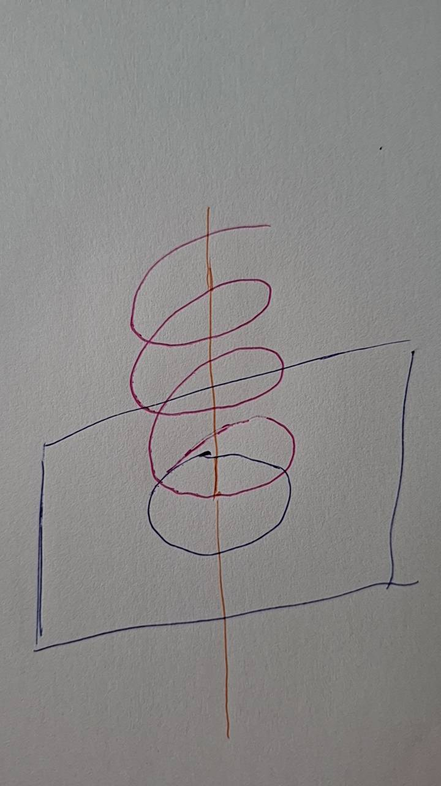
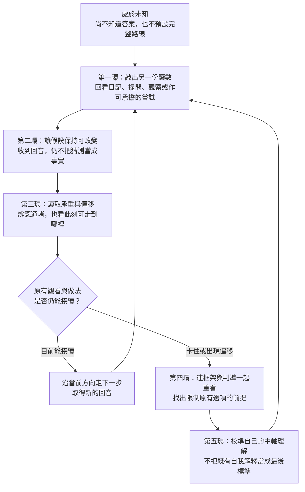

# 《生命導航學》體系發展參照地圖

**版本：v0.16｜日期：2026-11-11｜AB 判準與樞的動態承接修訂稿｜GitHub 公開閱讀版**

## 目錄

- [一 從認識完整的自己開始](#一-從認識完整的自己開始)
- [二 一張能往返的全體版圖](#二-一張能往返的全體版圖)
- [三 在尚不知去向時 路如何開始出現](#三-在尚不知去向時-路如何開始出現)
- [四 定位如何貫穿 中介如何隨現場生成](#四-定位如何貫穿-中介如何隨現場生成)
- [五 未知中的五環如何一起運轉](#五-未知中的五環如何一起運轉)
- [六 承重在使用中顯現 轉換在接手處成立](#六-承重在使用中顯現-轉換在接手處成立)
- [七 從不同現場看見同一套關係](#七-從不同現場看見同一套關係)
- [八 從自己的生活進入 再讓能力逐漸長出來](#八-從自己的生活進入-再讓能力逐漸長出來)
- [九 體系目前有哪些支撐 還能往哪裡長](#九-體系目前有哪些支撐-還能往哪裡長)
- [十 來源與版本紀錄](#十-來源與版本紀錄)

## 一 從認識完整的自己開始

《生命導航學》以認識完整的自己為根基，希望讓全人類看見「小我心智代碼」的存在，先看見它如何參與感知、解釋與決策，才有機會在反應發生時不再全然被它牽著走，逐漸取得選擇的餘地，依自由意志發揮潛能，使生命力朝向富生機面流轉。

這裡的自己，活在身體、心念、情緒、情感、關係與日常之中，也活在工作、制度、環境及更大的天地關係之中。不同領域、尺度與生命階段彼此牽動。身體已經疲累，可能改變一句話接得住多少；一個被當成事實的念頭，可能左右工作選擇；工作安排改變，又會影響家庭與身體。認識自己，就是在這些正在變動的關係中，逐漸看見自己如何感受、理解、選擇、承受與創造。

這份觀看也朝向內在：心智正替事情接上什麼解釋，心念如何被牽動，情緒怎樣變化，身體又有什麼反應。這些作用和外部發生的事同時在場，也會彼此影響。逐漸辨認它們，才可能看見哪些反應已有現實依據，哪些仍由自己的推想支持；外部新材料改變理解，內在的分辨也改變下一次接觸。認識自己於是同時發生在內外，不只表現為解決外面的問題。[1]

例如，原先只知道「我必須把這件事做好」，接觸實際情境後，才發現自己把「做好」綁在別人的一句評語上。看見這一層，並不替人決定要不要繼續；它讓原來沒有被察覺的牽動進入視野，當事人才有機會重新選擇。心智仍是可用的工具，情緒也仍有訊息；被釋放的生命力，可以回到真正想投入的事情上。這就是母願景在一件小事裡的作用，而它所朝向的，是更多人能如此生活、合作與創造。

人在開始時，往往連自己怎麼想、想去哪裡都還不清楚。可能只有一句「怪怪的」，可能被事情推到眼前，也可能在別人的求援裡碰見自己的未知。這些都可以是入口。地圖不要求先交出完整目標、自我分析或正確問題，才容許人走進來。

本文件所稱的「母文件」，是《生命導航學》奠基文件，保存這套思想的根本願景、理論及形成脈絡。本參照地圖將其中的理解連到實際運用，讓原本內化的關係取得可看、可問、可試、可核對的形狀。使用中的發現，也會反過來改變我們怎樣定位自己、他人及環境；有時改的是同一層的安排，有時連原先觀看問題的層次都要改變。它同時讓作者看見體系哪些部位已有支撐、哪些連接仍在形成，也讓不同熟練度的人找到自己的進入位置。新手可以先辨認眼前一小段；熟練者能讀出更多關係，甚至開出圖上還沒有的路。

提供參照，是為了讓人逐漸長出自己的導航能力。作者、帶領者、文字或工具，不需要成為每個人永久的必經之路。[1][2]

### 可以從哪裡進入

| 此刻的處境 | 可先讀的部分 | 讀時可以留意 |
|---|---|---|
| 想知道整套學問怎麼連在一起 | 第二節 全體版圖 | 各部分如何支撐並改變彼此 |
| 說不出目標，只知道有地方不對 | 第三節 未知中的一段路 | 問題本身如何在互動中改變 |
| 懂一些名詞，卻看不見怎麼運作 | 第四至六節 | 一個動作如何改變位置、承重與下一步 |
| 想從自己的生活開始使用 | 第七、八節 | 哪份材料現在接得到，哪些還不能判斷 |
| 想寫作、帶領他人或做跨領域研究 | 第八、九節 | 理解、接手、轉用及幫助他人實踐之間缺哪一段 |

讀完一段，可以回到自己的生活實作：試著觀察或接觸一件小事，再帶著實際回應回來閱讀。地圖中的關係會在不同處反覆出現；不必一次把所有名詞記住。

## 二 一張能往返的全體版圖

### 母願景如何貫穿各個部位

母願景使整體有了朝向。宇宙觀提供規律參照；定位辨認當下的關係；沿生命力回溯，追問眼前狀態如何形成；因果對帳讓解釋接受經驗、記錄與後續作用的核對；中介依定位生成可承接的動線。主權與持續校準貫穿全程，使理解及方法能回到當事人的生活，而不把人收進一套不可改動的答案。

| 體系部位 | 在現場做什麼 | 如何與其他部位相接 |
|---|---|---|
| 母願景與生命實作來源 | 追問完整的自己，保存思想如何從生活中長出 | 使方法的選擇回到生命，不被任務成績或工具形式接管 |
| 宇宙觀與共同的根本原理 | 以陰陽、開合樞等語言辨認關係與生成條件 | 為定位提供較深參照，也須辨明具體情境與適用尺度 |
| 3D 螺旋定位 | 辨認自己、他人、想望、環境、責任與負荷如何相互牽動 | 從每次接觸取得新材料，持續支撐中介的選用及調整 |
| 沿生命力回溯與因果對帳 | 從眼前通堵、矛盾與結果追查形成過程 | 讓原先的解釋被看見，找到可改動之處，再由作用後的結果修正理解 |
| 中介與承接 | 讓原來接不上的位置取得過渡條件 | 一句話、工具、時間安排或實際協助改變現場，回音再進入定位 |
| 案例、圖文、方法與練習 | 使他人有可觀看、可接觸、可嘗試的材料 | 由讀者實際怎麼接手，修正表達、安排及對原理的理解 |
| 自行運用、跨域轉用與傳承實踐 | 在新情境中生成下一步，也能幫助別人形成能力 | 把新成果、失效與未解問題帶回整體，重新辨認各部分如何相接、原有觀看層次是否仍適用 |

縱向，是深層理解如何變成可辨認、可操作、可由他人理解並實踐的內容；橫向，是身體、自我認識、人際、工作、制度與 AI 治理等領域。每一層都可以往返：一個詞接不上，可能要修表達，也可能暴露定位錯誤；一次工具失效，可能要換工具，也可能要重新查問原來的目的。不能只把失敗推給使用者不夠懂。

這些名稱描述同一段生活中不同的作用。例如，原先以為朋友需要建議，問過才發現他連眼前發生什麼都說不清；這份回應改變了對朋友位置的理解，也使「給建議」暫時退位，下一步轉成一起釐清事件。新問題帶出新的材料，朋友和自己又可能因此改變理解。定位使中介有所依據，中介的作用又改變定位，並非先做完一欄，再交給下一欄。

五環導航描寫這種運作在未知中如何逐步展開、辨認偏移及重新校準；母結構則追問，為什麼換了問題與領域，仍能重新辨認關係、生成接續。前者展開動線，後者說明動線得以改變而仍相連的關係。第三、四節先從生活看它們怎樣發生，第五節再沿五環逐一讀取。[1][2][11][12]

### 3D 螺旋裡也有 3D 螺旋

下圖是母文件的定位模型。初次閱讀時，先看平面、中央軸和螺旋之間的關係，不必一次讀懂圖中所有細節。

這張定位模型原圖以平面、中央軸與螺旋，提供觀看關係的入口。中央垂直貫穿的是**自己的中軸**。它從認識自己而來，使人向外接觸時仍有回返、比對與承擔選擇的位置。

向外探索與回到中軸互為條件。有可回返及比對的位置，才較能放開探索；新的接觸又使中軸的使用保持活性，不讓回返只是重複舊答案。探索取得材料，回返分辨它與自己及現實的關係，分辨所得再支持下一次探索。兩者共同使螺旋持續生成。[1]

在當前一層中，人可能嘗試幾種方法，逐漸辨認哪些接得上。定位初稿把這個差異寫得很具體：一種方法不合，可以在同一層換方法再試；若換來換去都接不上，就要重新看原先把這個人、問題與方法放在什麼位置。也許不是方法還不夠多，而是起初理解他的方式漏掉了一個關鍵條件。[10]

例如，本來一直想「怎樣讓自己更願意做」，後來發現自己並不認同那個目標，卻把別人的期待當成自己的責任。此時再增加提醒、獎勵或自律，仍是在原來的平面裡移動；讓「這是誰的目標、我為何承接它」進入觀看，才可能改變整個安排。這是說明定位轉變的日常示例，不替任何人的處境預定答案。

螺旋用來呈現這種認識與運作層次的轉變。新的理解仍要落回生活，取得可承擔的做法：該商量什麼、重新分配什麼、保留哪些責任。中介使轉變有落腳處，實作回應再讓人知道，新的定位是否接得上。再遇相似問題時，要看這一次能辨認什麼、承接多少、有哪些新選擇，才能知道改變發生在哪裡。

同時，每一個「點」裡還有正在運動的關係。眼前的朋友，有自己的身體、工作、家人、恐懼、想望與判準；我也有。朋友一句新的回應，既可能改變我對他的理解，也可能改變他對自己的理解，還會改變我們接下來能談什麼。兩人各自的內部變化，和兩人構成的整體互動同時在場。

「全息」與「遞迴自相似」在此指向：放大局部，仍能辨認這類關係結構；縮小觀看，原先的整體又成為更大關係的一部分。這使定位可以由一句話延伸到一個人、一次合作或一套制度，卻不表示行動者在某一刻已知道所有層次的全部內容。[1][2]

### 天道 生機 中軸與目標各在什麼位置

- **天道**是作者對宇宙底層物理規律的稱呼，是體系的規律參照。人對它的理解仍須持續辨認與核對。
- **生機**可與「死寂」對照來理解：一個地方可能每天都很忙、流程照常運轉，身在其中的人卻只能消耗自己去維持既定形式，感受、選擇和創造力沒有容身之處。這種忙碌不等於有生機。生機所關心的是：生命能否恢復、交換、學習，讓原先沒有的可能性長出來。秩序若能支持這些作用，也能富有生機；關鍵不在忙或不忙，而在安排如何作用於自己、他人及環境，並帶來什麼後續。
- **中軸**是自己的定位與比對位置。母文件以「不儲存內容的比對器」說明：不讓某個身分、成功經驗或固定目標佔住這個位置，免得所有新材料都只能替舊答案服務。
- **具體目標**是此刻想完成的事。它可能已明確，也可能尚在形成；情況改變時，可以重定、縮小或退位。

初讀時，可以先保留一個問題：怎樣改動，能使原來接不上的關係重新流通，又不把代價轉嫁給別處？這個問題會貫穿後面的定位、中介與承重。第九節再說明母文件如何把這些作用接回共同的根本原理。

這些表達用來照亮不同層次的作用，不能因名稱相接，就省去各層的條件與核對。這張圖中的軸、半徑與螺旋是體系的結構語言，並非已建立適用於所有人的量測方程。[1]

## 三 在尚不知去向時 路如何開始出現

先從一個容易想像的生活情境進入，再看一段實際發生的人機對話。兩段都還不知道完整答案；可走的路，是接觸之後才逐漸長出來的。

### 情境推演：水槽排水不良 下一步從哪裡來

以下整理自作者與 AI 的問答推演，並非一次已完成的修繕紀錄。當時設下的情境是：手邊有表格要填，廚房水槽又排水不良，先做哪件事？

作者沒有只憑「堵住了」就決定先修水槽。她先問，排水不良影響哪些事、影響多廣、急不急。若不急、影響又小，便可以先填表；當情境補上家人很快需要使用廚房，水槽就成了眼前需要先處理的地方。表格沒有因此變得無用，水槽也沒有取得永遠優先的位置。生活的接續需要改變了，兩件事的先後才跟著改變。

走到水槽前，她也沒有先選清潔方法，而是問誰發現、何時發生、當時在做什麼，再往前問之前誰用過、做了什麼。原本混在一句「堵住了」裡的事情，開始有了時間、使用者與操作上的差異。這些差異讓後續觀察有方向，卻還沒有證明堵塞原因。

問答接著涉及油污，以及如何取得清理方法。作者提出向知道的人詢問；沒有合適答案，就另查資料或問五金行。此時她原先以為水管材質相同，AI 提醒材質可能不同，她便將「怎麼清理」轉成「先確認這根管子適用什麼方法」。家人若分不清，就詢問店家如何辨認；口頭說不清，可以帶照片讓對方查看。管材與方法的適用條件於是進入現場，下一次查問也換了內容與媒介。[14]

到這裡，修繕尚未完成，但已能看見一個關鍵：**下一步不必等全部知道才出現；它可以先是取得眼前缺少、又會影響後續選擇的那份材料。** 原先不知道材質差異，不代表必須先學完整套管路知識；新的提醒使這一項未知浮出來，便先為它找到可確認的途徑。詢問專業者也仍須帶回適用條件，而非僅憑一句推薦便結束核對。

這段推演的用途，是看見判斷如何接續，不是提供清潔劑、管材辨識或徒手檢查的操作指引。

### 這段路裡 哪些東西在一起改變

起初要分辨的是事情的影響與時機，接著是異常前後發生過什麼，再來是眼前方法能不能用在這根管子上。所比較的兩端一直在變，分辨的用途卻相連：讓原本看不清的關係取得足以支持下一步的差異。

每次分辨都沒有把事情拆成互不相干的碎片。表格和水槽仍在同一段生活時間裡；油污線索仍須放回使用經過與管路條件；店家的知識也要接到眼前這根管子才有作用。只留下任何一個答案，例如「先修水槽」或「問專家」，便會漏掉它為何在那一刻成立，以及何時需要改變。

這裡先用白話認識三個名稱：**AB 判準**，是依當前需要辨認有作用的差異；**相依**，是在分辨差異時，仍看兩端如何牽動、支持或限制彼此；**樞**，則參與這份差異如何取得位置、又如何轉成可接續的作用。水槽是否妨礙家人接下來的生活，讓兩件事的先後有了判斷位置；照片若能讓專業者辨認眼前條件，又會成為從「說不清」走向「可以核對」的中介。樞的作用不固定由同一個人、物品或問句擔任。

這些名稱稍後還會展開。此刻先看見：新的回應改變了理解，理解改變了查問與安排，新的安排再讓下一份現實能被接觸。這就是定位與中介相互生成的地方。

### 案例：一句「已經夠了」為何沒有解開困惑

作者在一段研究瓶頸中，不知道下一步該往哪裡走。母文件與實驗已累積許多內容，得到的回應卻反覆是「夠了，先休息」。她的困惑是：究竟哪裡夠了，能承受什麼，休息之後又憑什麼知道怎麼走？

她以料理豬肉作比喻：手上有一塊肉，但不知道部位、重量與條件，如何決定怎麼料理？這時候，問題尚未被說成成熟的理論命題。比喻先替那份難以表達的困惑取得一個可交給對方觀看的形狀。

AI 接著把成果分成幾個部位，給出完成比例及固定的料理建議。文字更詳細了，原來的困惑卻仍在。作者指出，細節會隨實務改變，她要看的，是陰陽如何相依、以什麼為樞來判斷；接著把問題轉成：「驗證器憑什麼有資格當驗證器？」[3]

這一問使整個場景換了觀看位置。原先的討論把「已經夠了」當成前提，只在下面安排後續工作；現在，這個前提本身被拿來查問：

說一份文件夠了，是對哪一種用途而言？整理自己的思想、讓陌生人讀懂、讓另一個人能用，或讓模型在新環境自行接續，是不同的工作。文字內容整理完成，能支持其中某一段，卻不能替尚未發生的運用取得結果。

討論由此接上另一個判斷：若眼前需要知道的是「底稿在真實使用中能支撐什麼」，而繼續內部改字已沒有新材料可核對，那麼下一筆讀數須從使用中取得；同時，使用它的人也需要恢復體力。這是當時那一段工作的定位，不是所有文件一律停止修訂的規則。

作者認出這正是自己想問的答案，先去睡覺。隔天，她又追問：若本階段實驗告一段落，下一個外部交換究竟是什麼？要另外摸索，還是像先前一樣，在沒有預定目的的對話中逐漸浮現？[3]

到這裡，已發生了一個真實轉換：她能分辨「目前可先停下什麼」及「後續需要由哪類接觸取得新材料」，但尚不知道下一段人生或研究的具體去向。局部明白與整體未知可以同時存在。

### 從案例看定位與中介

這裡的「定位」，就是持續辨認當下誰處於什麼狀態、什麼已知、哪些仍待確認；「中介」，則是依當下條件，讓原本接不上的理解或行動有路可接。例如一個比喻，可以讓雙方終於看見同一個問題。

回頭看這段互動，定位從未離場：作者的疲累、已有成果、AI 的理解、問題被放在哪一層，都在持續變動。中介也隨之改變，先是比喻，再是校正，再是追問判準。回應接不上，使下一次提問有了線索；提問又改變雙方正在討論的對象。真正推進的，不只是多得一個答案，而是原本讓人反覆打轉的前提失去支配力，新的行動條件開始出現。

讀者可以先抓住其中一小段：當一個回覆「聽起來有道理，卻仍沒有回答我的困惑」，不用立刻知道它錯在哪裡。先把接不上的原話留下，讓它和自己的感受、眼前事實並排。這份差異已有用途，後面還可以繼續查問。

## 四 定位如何貫穿 中介如何隨現場生成

### 定位從來沒有在行動前結束

定位關心的是：此刻誰在經歷什麼，哪些關係正在作用，什麼已知、什麼還不知道，誰能決定、誰在承擔，生命力在哪裡通暢或被耗住。這份辨認包含自己，也包含對方及環境。

關係中常用「我的位置、對方的位置、對方目標的位置」來閱讀。把自己的當下目標展開，便有四點視角；觀看個人的生活處境，也可以由「自我、目標、環境」切入。不同切法是為了看見當前關係。沒有目標的答案時，那個位置就先保留未知；對方說出的想望，也還要放回他的生活中理解。

每一個位置又有自己的內部運動。自己可能一面擔心對方，一面已經累到接不住；對方可能想改善處境，卻還無法放掉一項重要關係。當下要問的，不只是「他想不想改變」，還包括什麼使他現在這樣選、改變會牽動什麼，以及此刻有沒有可承接的條件。

因此，定位貫穿發問、聆聽、回溯、對帳、選工具、施力、停手及後續安排。中介要依這份定位才能成立；作用後的回音，又讓定位有機會更新。兩者在操作中相互牽動，定位仍是全程的基底。[1]

### 一個動作同時取得材料 也改變關係

作者對自己與人互動的描述很直接：

> 「我面對的永遠是未知……我完全是依靠觀察、溝通互動去逼近答案的……若要講成結構，都是同一套：定位＋中介。」[4]

這意味著，發問時並沒有一個已被看穿的完整對方。若只是把對方當成等待揭露的固定答案，會漏掉接觸本身的作用。

以下是日常情境的示例，不是案例原話。一句「你剛才說的『沒事』，和你平時的說法有點不同，是我理解錯了嗎？」可能讓對方補充一個原先沒說的條件，也可能讓對方第一次注意自己的矛盾；他也可能表示不想談。這些不同回應，使雙方的下一步不同。問話者也在其中受校正，而不是只蒐集用來證明自己看得準的材料。

中介由此生成：哪些話現在接得上，哪個問題值得先問，這次要給多少，需不需要換成陪伴、資料、實際安排或暫停。取得回音之後，原來選好的方式可能保留，也可能減量、換位置或退場。

這是一個有時間先後、卻不分割成獨立工序的運動：

**帶著當下所知接觸現場，讓作用與回應改變可見的關係；依新位置調整下一步，並看它實際改變了什麼。**

定位也會由未經自己發起的事件更新：對方突然來訊、身體狀態改變、外部期限調整，都可能帶來新材料。不能把所有讀數都說成由操作者刻意製造。

### 不先把人的訊息變成標籤

「讀數」是此刻實際取得的材料，如一段話、身體感受、一個動作、事件結果或記錄。它與對材料的解釋須能分辨，但分辨不等於把人抽空。

「故事－形容詞＝物理事實」提供一個入口：先減去評價，查問發生過什麼，再把形容詞放回這個人的慣常表達與當下處境。作者的補正是：

> 「去掉是為了還原事實，加回來是要重新定位對方的情緒位置，而且不能只根據用詞本身，而要根據他本人習慣用詞，才能確定該形容詞在當下對他來說強烈度在光譜的那一個點上。」[5]

同樣說「很痛」，對一個很少說痛的人，與一個習慣用強烈詞語的人，意義可能不同；身體、工作與關係的近期變化也可能使舊參照需要更新。這份「加回來」先幫助讀取他的位置，才影響要給什麼回應。它不是只為了讓措辭溫柔。

刪去形容詞後留下的敘述仍要核對；情緒也不能因此被當成不重要的雜訊。母文件把「情」理解為生命在內外接觸中的偏向性流動，它讓我們追問此刻在靠近什麼、避開什麼、哪裡正在開或合。身體、情緒、心念與認知運算各提供不同材料；單憑其中一種，還不能替所有原因下結論。[1]

### 分辨時保留相依 樞也在其中取得作用

「AB 判準」包含兩個相連的問題：這次依什麼辨認差異，以及這個差異能讓哪一段關係接續。A、B 可以是兩種說法、兩個位置或兩種狀態；在未知中，它們往往要經過接觸才逐漸明朗。水槽推演裡，先比較影響與急切性，才決定先處理什麼；得知管材可能不同後，原先的清理問題又轉成辨認適用條件。判準隨現實展開，下一次要比較什麼也跟著改變。

作者曾從觀察輪子理解「相依」。可以想像一個轉動的輪子：以輪軸為參照，輪緣相對兩側的瞬時運動方向相反，卻同屬一個連續轉動；換到地面觀看，還須計入輪子整體的移動。局部方向不同，不能直接當成彼此抵消、互不相干。在這裡，「陰陽」指向的正是這種辨認方式：區分同一運動中不同的作用，同時看見它們如何相互依存、隨位置而轉換。作者由這個觀察入口，逐漸把「相對」讀成可以共同生成的關係。[10]

放回生活，給予與恢復也能這樣看。持續給予需要恢復來支撐，恢復之後又可能有新的給予；此刻如何安排，要連著自己、對方、份量、時間及後續作用一起讀。固定要求「多給一點」或「先保護自己」，都可能漏掉眼前正在變動的條件。

**每一次用什麼作為樞，要回到這一刻已有什麼能共同承接，以及它能承接到哪裡。** 「共同底稿」是已能共同使用的理解、材料或實作基礎；它不必是一份文件。作者在原始對話裡說：「共同底稿，就是承重點。」意思是，已有內容真正接上了某個用途，才形成下一步可站立的位置。承重因此不只在問投入是否太多，也在辨認：這份理解與眼前的人、工具、環境接在一起，現在究竟支撐得起哪個轉換。[15]

例如，一份文件已能讓雙方看向同一個問題，卻還不能讓讀者獨立操作。若眼前卡住的是「接下來怎麼學會使用」，繼續要求文件先寫到能包辦所有情境，可能只會讓工作停在原處。辨認出它已能承擔共同參照的作用，便可以把下一步移到實際使用：在一個具體情境中試著接手，看哪裡接得上、哪裡還缺條件，再把新發現帶回文件。這時使關係轉動的樞，是「現有底稿已能支撐這一次實作」的辨認，以及隨之成立的接手安排。若連同一個問題都還沒有看見，則要先改變說明或取得材料，不能照搬這個安排。[15]

所以，發現一個「洞」，還要看它在哪一段生成關係裡。這裡的洞，是從一個位置走向另一個位置時接不上的地方：資料到了卻讀不懂、讀懂了卻沒有實作條件、已經動手卻收不到可校正的回應。作者確認的問法是：「A 到 B 的生成關係目前在哪裡接不起來？這個未接起的狀態，是否已經影響當前目的或下一個轉換？」關係一變，某處可能成為眼前需要承接的地方；也可能暫時不影響接續，或需要先保留未知。能用來接通的話、工具、時機或人，也須隨這次定位而定。[15]

這份判斷在作者的實作中，常先以整體動線的感受發生。她以居家整理說明：重排時關注動線順不順，身體的卡滯與思緒是否清爽參與辨認；不順便繼續重排，某次配置接上時，安排才第一次取得定位，原先在背景的一處也隨之浮到眼前。這段自述讓人看見，樞如何從關係重新排列的過程中顯現，而非先列出所有洞，再挑最大的一個。[15]

已浮現的安排還要進入現實，才能知道作用是否過猛、過少，或遺漏了條件。新回應會改變共同底稿能承擔的範圍，也可能使原來的樞退位。於是，AB 的切分、樞的選取與承重的辨認在同一段往返中更新：先讓這一處接得上，接上後再看下一處如何生成。作者所說「難在轉換邊串連了幾個，串得多好」，指向的就是這份連續接續，而不只是某一次判斷有了漂亮答案。[11][12][15]

### 回溯改變定位 定位也改變要追問的範圍

眼前的堵塞可能有多種來源。同一句「我不能拒絕」，可能連著現實生計、對失去關係的擔心、過去形成的自我要求，或眼前確有其事的責任。回溯沿著這個人實際的生命流動，查問哪些條件共同形成了現在，避免一開始就指定原因。

若新材料顯示眼前確有不能中斷的照護責任，接下來要找的可能是接班與休息，而不只是練習說不；若發現事情已有他人接手，自己卻仍以「只有我能做」承擔全部，就要連這個認知一起看。相似的一句話，因為生成它的關係不同，需要的中介也不同。這是說明差異的示例，不是替說出這句話的人預定分類。

回溯不要求每次都追到最遠的起源。眼前材料已足以支持一次相稱的詢問或安排，就可以先接續；若仍卡住，再看缺的是資訊、條件，還是原先的觀看方式。原來問「要選 A 工具還是 B 工具」，可能轉成「目前的生活動線需要什麼作用」；原來問「為何這個人不配合」，可能轉成「這個安排是否讓他有能力、有權限及有理由接手」。

新的問法改變了可以查什麼，也可能使原來互相衝突的選項不再是唯一選項。但轉換仍要落地：由誰接手、何時能開始、怎樣取得回應。若只換了抽象說法，現場仍無從接續，便還要尋找中介。第四環的觀看層次轉變，正是在這類往返裡取得實際作用。[1][10][11]

### 承接與主權一直在同一場裡

接收位置也是定位的一部分。同一內容，被聽成「你有問題，我知道答案」，與被理解為「我們一起看看發生什麼」，可能產生不同作用；實際如何接收，仍要由對方的回應辨認，不能只憑設計者想像。

當舊理解鬆動，人可能一時站不穩。此時的中介需要照顧可承載的下一步，可能是基本生活、身體休養、工作安排、可用的人際支持，也可能只是一個足夠清楚的觀察。「虛不受補，先溫中土」提醒的是這份承接關係；給得更多、更深，未必更有用。

作者所說「只能給對方多一層，而且是他要的」，須放回動態定位來讀。相對份量由現場測出，會增加、減少、換語言、換時機，也可能停下。熟悉對方，不能使當下的回應變成已知。

主權從開始就屬於當事人。帶領者可以遞出觀察、幫助分辨、提供條件，當事人仍能補充、拒絕或另選一條路。承接者本身也在整體裡，有身體、時間、能力與受託範圍。支持可以保留、減量、交棒或退出；留下日後可用的種子，也是一種安排，但不預定它何時發芽。[1][4]

## 五 未知中的五環如何一起運轉

前面看的是差異、相依與樞如何使下一步生成；五環則沿時間把這次實作中連成一氣的動作展開：先向未知踏出一小步，取得另一份讀數；有了回應，仍不急著把猜測當成事實；再讀取其中的通堵、承重與偏移。若沿原來的觀看方式走不通，就連框架和判準一起重看；當自己的中軸理解也成為疑問，再進一步校準它，回到下一次接觸。

這條動線有先後關係。沒有取得回應，便沒有這次可比對的材料；把回應過早定成答案，後面的辨認也會被鎖住。熟練時，幾個作用可能迅速銜接、彼此回看，感受和行動也可能先於語言；這不會使原本相接的動作失去順序。以下先用圖看見動作如何相接，再逐環閱讀它們的作用與回返。[1][3]

### 五環動線圖：從取得回音到重新校準

先順著實線讀一遍：第一環接第二環，第二環接第三環；第三環的讀數使人辨認，眼前可以接續，還是需要往第四、第五環重看。定位與中介貫穿這條路：每次接觸都帶回材料，每次分辨都可能改變下一個動作。

圖保留從第一到第五環的連續關係，也保留原圖中「能接續便回到下一筆讀數」的分支。它描寫作用如何相接，不承諾每次都能完成校準。回返時，前一輪的觀察與調整會進入下一輪；同時發生的覺察，也可以使人回看較前面的環節。

### 第一環 讓未知取得另一份讀數

當腦中只剩同一套說法，可以讓另一份不完全受它支配的材料進場。回看日記、個人實作記錄或當時的原話，問一個具體問題，或在可承受的範圍內試一個小改動，都可能形成接觸。

這一步可以先只為了看清某一處差異，不必替整段人生押上答案。差異出現後，位置可能更清楚，也可能只是知道「原來還缺這一塊」。未知還在，下一次查問已經有了落點。

可逆與低代價要由情境判斷。涉及急症、人身安全或不可回復後果時，下一步往往是及時尋求專業協助或先止損，而非任意試探。

### 第二環 讓假設保持可以被改變

人可能很快把一個訊號接成完整故事：一次失敗變成「我就是沒用」，一次順利變成「以後都該這樣」。心智一旦把推測當成現實，後續材料便容易被納入同一劇本。

「不猜／舞步未定」保留的是辨認與調整的空間。有根據的推理可以先支持有限行動，同時把還不知道的部分留在可核對的位置。情緒升起時也能繼續觀察，不必先消除情緒才有資格判斷。

例如，聽見一聲巨響而生起「發生什麼事？」的心念，與依聲音、位置及現場材料推理原因，並不等於已經陷入心智幻象。這裡要辨認的，是心智是否在材料不足時補出一個故事，接著把它當成確定的現實。

母文件把「3～5 秒」描述為心智幻象短暫冒起的觀察窗口：一個猜想本來可能很快消散，但一旦當真，後面的心念、情緒與推理會接著運作，使原本未經確認的故事持續影響自己。這裡說的是作者對自身經驗的辨認，不是以感受的持續時間判定事件真假的測驗。

由此提供一個簡易起手式：當一個念頭冒出，先看它怎樣出現、延續或消散，不立刻跟著補故事；也不急著壓制、消滅它。藉這一小段觀看，開始分辨眼前確實收到的訊息、依據訊息進行的推理，以及自己續接的想像。[1]

這是作者為容易開始練習而提出的觀察入口，不是用秒數一刀判定所有念頭真假的規則，也不是唯一或最佳方法。更根本的方向，是提升覺知力：越能看見心智正在怎麼運作，越不需要等到故事已把自己帶走，才回頭查找。

### 第三環 讀到承重變化 也辨認此刻停在哪裡

有時，一段解釋每句都像有道理，自己卻始終覺得哪裡不對；直到其中一個關係被說清楚，原本卡著的感覺才鬆開。這裡先不把感受等同答案，而是保留「文字看似順暢，自己卻接不上」這份差異，繼續核對。

作者把自己的這類內在參照比喻為「那杯水」：關係不相合時，水像被擾動；接上時，才有相對安定的回應。這個比喻描述她如何讀取身體訊號，不要求讀者想像身體裡真有一杯水。

那杯水也關乎遞迴定位停在哪一層。關係可以繼續向內展開，卻不以越深越好；母文件以「水靜了」描述當前一層的理解與現實接通、能承重時的身體回應。若已足以支持眼前相稱的下一步，就可先在這裡接續，不必為了找最終答案而無限往下追。後續仍不通，或新材料改變了原判斷，再回查尚未看清的關係。停留依當前問題的承重而定，並非宣告這一層就是最後真相。[1]

對另一個人而言，可用訊號可能不同。有人先注意睡眠與疲勞，有人先看見自己反覆答應又無法做到，有人需要實際記錄才能看出模式。重要的是逐漸建立自己的參照，而非模仿作者的身體反應。

警訊使注意力停下來，原因仍須追查。疲累可能使思考變窄，碰到重要問題也可能讓人不舒服；舒服不能單獨證明判斷正確，不舒服也不能單獨證明方向錯誤。定位把感受與實際條件放在一起，中介據此決定是否減量、換方式、求援或暫停。

### 第四環 卡住時 連判準也拿來重新看

這一環的困難，在於人通常比較容易在原有規則內換答案，卻不容易看見規則本身正在限制答案。例如，一直問「怎樣讓所有人滿意」，再換十種做法，仍可能被「必須所有人滿意才算成功」框住。要鬆動的不是第十一個方案，而是這個從未被拿來查問的標準。這是說明差別的示例，不是要求人一發現就能立刻放下。

原有框架往往連著安全感、責任、關係和過去的成功；即使看見問題，實際改變也可能要經過反覆試探、支持與調整。在同一個問題裡換了幾種做法，卻仍回到原處，可以查問：是哪個共同前提限制了所有選項？原來的分類、責任安排或完成標準，現在還適用嗎？

第三節裡，「夠了之後怎麼做」轉成「憑什麼說夠了」，便讓驗證器和它的判準一起成為被觀看的對象。分辨由此深入，原來的工具也可以重組。

換觀看層次後，還要回到可做之處：新的區分究竟容許哪個先前做不到的行動？由誰接手？回應又可能推翻什麼？若這些仍不清楚，就保留為待查，不以「升維」替結果蓋章。

### 第五環 連自己的中軸理解也保留校準

第五環更進一步：要重新看的，可能已不是「我用哪個標準」，而是「我把什麼當成了不可改動的我」。若「我必須永遠是有用的人」已與自我價值黏在一起，少承擔一件事就可能被感受為否定整個自己。此時，理解一句「你可以休息」，與真正能讓這個自我要求鬆動，之間有很大的距離。

這也說明，覺察並不是一句口號，更不是讀懂段落就已完成的功夫。這裡所說的校準，不是抹去一個人的存在、情感與需要，而是讓用來認識自己的身分和解釋，仍能接受現實的回應，不把它們當成自己的全部。

人在未知中會懷疑自己：當下這份堅持究竟來自真實需要，還是已被固定身分、過往成功或沉沒成本牽住？這時，中軸不能只是「我過去一直如此」的另一個名稱。

母體系以對齊天道作為更深的校準關係：自己的理解要向規律及現實開放，不能因出自自己便取得最後裁決權。落到生活，可以查問：現在維持的形式，實際讓哪些生命與關係有了生成空間？代價由誰承受？哪些後果被排除在外？若工具已吞掉目的，能否讓工具退位？

這些問題也包括自己。為了幫助所有人而耗盡自身，不因出發點良好就自動符合全局生機；立即輕鬆也未必代表長期有益。方向需要由不同尺度與後續作用繼續對帳。

回正因此是一份持續的能力與工作。作者在原始提問中明說，她也會困惑、偏移，所指的是相對較早察覺與較能拉回，並非永遠不會偏離。把這份描述寫成必然、自動的保證，反而關閉了它賴以成立的校準。[3]

### 五環會在同一個接觸點再次展開

沿著動線走過一次，下一筆回音又使五環重新展開。第三環讀到卡滯時，會回看第二環是否已把猜測當真，再以第一環取得新材料；第四環換了判準，也要把新判準帶回接觸中核對。這些回看是在連續運作中發生，不把原有順序拆成互不相連的功能清單。

回到第三節的水槽推演，詢問、取得回應、保留未定原因，以及察覺管材條件尚未確認，都讓下一步重新定位。這段材料並未呈現一場自我身分鬆動的完整歷程，便不把它硬填成五環全走完的故事。第三節另一段「夠了」的對話，才進一步讓原先裁定成果的標準本身成為問題。不同材料照亮不同接續位置，五環圖提供的是可回看的完整動線。

因此，小到一句話、大到一段合作，既有局部的五環，也有整體的方向與承重。沒有必要為了跑完流程而硬做下一環；也不必等到失敗，才允許回到中軸。

### 讓眼前重新走得動 也逐步形成自己的導航能力

一個人卡住時，眼前需要的可能是把事情看清楚、鬆開妨礙行動的前提，或重新安排可承接的下一步。例如，原先以為只能自己完成的工作，經查問才發現責任可以重新分配，於是耗住他的關係有了轉動空間。體系以「除錯復位」稱呼這一面：從當下的卡滯回看它怎麼形成，辨認錯位，讓原本接不上的地方重新接續。

另一個問題隨之出現：這次有人幫忙把關係理順了，下一次遇到從未碰過的情境，自己如何看見、如何決定、又如何知道該停下或調整？這是「引擎生成」關心的事。「引擎」比喻一組能在現場運作的能力：讀取正在發生的變化、依當下關係生成回應、察覺自己已承擔不住時煞車，並讓行動結果回來校正理解。它所要形成的，是這些能力能彼此接續，而非只記住這次成功的解法。[1]

兩面可以在同一次生活實作裡相互調用。嘗試一個新安排時，若察覺又被舊前提牽回去，就需要回溯、拆結與復位；堵塞鬆開後，新取得的空間則讓下一個嘗試成為可能。在嘗試中反覆讀取與校正，也讓人有機會逐漸形成自己的導航能力。已有能力的人，同樣需要除錯與復位；正在學習的人，也可以從當下接得住的一小段開始，不必等待所有困惑都消失。

不過，清開眼前的堵塞、描述這組能力如何運作，以及讓另一個人逐步練出能力，是三件需要接起來的工作。一次恢復順暢，尚未回答下次能否自行讀取與調整。母文件已把「如何形成可供他人練習的逐步路徑」保留為待建構的部分；五環有助於展開運作，但還需要具體的練習、回應與承接條件，才能知道能力在哪些地方開始形成、哪些地方仍需要協助。[1][3][16]

## 六 承重在使用中顯現 轉換在接手處成立

### 同一根樹枝 為什麼能做的事一直在變

作者借武學談承重：熟練的人隨手拿起身邊之物，也能依局勢使用它；判斷包含人、工具、對方、距離、速度、時間與可移動空間。條件一改，值得施力的位置也跟著改。[2]

這個比喻可以使動態關係變得可見。樹枝的粗細與彈性提供一部分條件，握持方式、彼此距離、身體狀態與退路也共同決定它此刻能做什麼。靠近時可用的方式，拉開距離後未必仍有效；一處接觸帶來新讀數，人的位置與施力便須跟著調整。

五環在其中各有作用：取得接觸而不預製全套招式，保持判斷可改，讀到負荷變化，必要時改動原來的用法，並重新校準整體方向。這是用來理解關係的比喻，不是戰鬥技法，也沒有「拿樹枝一定不會折斷」的效果保證。

放回生活，一個曾經有效的建議、一份報告、一張表，都像手邊可用的材料。作用取決於它此刻與哪些人、用途及條件接上，不能由它過去成功便認定這次也足夠。

### 五個相互牽動的承重面向

承重可以從幾個面向一起看：

1. **人的狀態與能力。** 體力、理解、意願、注意力與目前負荷，影響能接哪一段。
2. **關係與通道。** 信任、語言、角色與接收位置，影響材料能否到達並被使用。
3. **工具與材料。** 它有什麼功能、依據、限制，能支持什麼用途。
4. **時空與環境。** 時機、期限、距離、制度、資源與外部變化，決定某條路現在是否還可走。
5. **後果與回返。** 行動後誰承擔、回應回到哪裡，哪些部分能修正、撤回或交棒。

這五面是閱讀入口，不是窮盡所有條件的檢核表。它們會互相改變：縮小一次工作，可能讓體力恢復、交付提早、對方有時間回應；但若縮掉關鍵依據，也可能使整份材料失去用途。工具沒壞，安排仍可能不再合適。

因此，「夠不夠」需要連著用途、時間與承接者說。沒有共同分母的百分比，只會讓不明變得像已知。對眼前一小步夠用，也不代表對後面所有工作都夠用。

### 兩端都在 不代表中間已經接通

「轉換邊」指的是兩個位置之間真正發生的接續。察覺一個異樣，是否形成相稱的查問？已有決定，是否送到能執行的人？材料到了，對方是否能用？新的結果，是否改變下一步？

一個人說懂了，可以是重要的回應，但還沒有告訴我們他能在什麼情況下使用。文字裡有方法、讀者也願意讀，仍可能卡在某個字義；文件寄出、對方收到，也可能沒有形成後續工作。把這些中間位置看清，才知道要修的是內容、通道、時機、權責，還是根本不該沿用原來的安排。

「共同底稿」就在實際接手裡逐漸顯現。雙方能一起使用到哪裡，哪些字各有不同理解，哪些部分還需在場者協助，都會留下具體範圍。已走通的部分成為新支撐，尚未接上的部分也有了可查的位置。

作者用「功能足以上路時，就去做，出問題了就修，久了，就有功能基礎參照值」描述這種實作。足以支持的下一步，可以是提問、局部交付、取得專業判斷或暫停；份量要與後果相稱。[5]

### 量 時機與作用方向要一起看

增加內容、投入時間或提高強度，只是改變了量。是否更有作用，要看它有沒有改變真正卡住的關係。對方尚未理解一個關鍵區別時，再講十個道理可能只會增加負荷；若問題是資料未送到有權處理的人，增加努力也可能在錯的位置累積。

母文件以「權、生機、時中」相接：此刻往哪裡動，是否仍服務整體生機，動多少、何時動。生機貫穿這份判斷，執行、檢驗與修正也在其中並行。一次作用無效時，要能回查原判斷，不能只把劑量加大。[1]

### 已有成果何時需要退位

退位是讓不再適用的效力退出當前用途，保留仍有用的部分與歷史。原本預留的缺口被補上，可能使舊安排繼續成立；若支撐安排的關鍵依據改變，則可能需要重新確認、縮小或撤回。兩者不能只因「都有新資訊」便作同一處理。

文件亦然。當內部閱讀已足以支持一次實際使用，就可以讓使用發生，取得它究竟承住什麼的讀數；若使用揭露新的概念斷裂，還可以回來改文件。這裡不需要宣布文字已「完全閉合」或理論已「百分之百滿載」，只需說清當下已有什麼支撐，以及下一筆材料從哪裡取得。

## 七 從不同現場看見同一套關係

### 一 案例：比較兩套工具之前 先看它們要服務什麼生活

這個案例發生在作者檢視 AI 研究成果時。她手上有兩組材料：A 是 AI 在對話中提出的程式框架與沙盒，B 是第十三次實驗累積的程式和理解。她不熟程式，卻清楚自己要實現什麼作用，想知道兩者哪些值得保留、哪些應排除，以及能不能重新搭配。討論一度停在「A 有哪些零件，B 是否已經有；A 還能補 B 什麼」。這樣可以辨認局部功能，卻尚未回答整個安排如何運作。

作者用居家整理重述自己的問題：先依心目中的居家設計，辨認什麼要留、什麼不用，再看 A、B 收納物件如何使用，必要時拆開混搭；重點還包括各種可能的動線。她當時不是要求選一個比較好的收納盒，而是要看既有材料能否重新組成有作用的生活安排。[4]

比喻改變了彼此的接收位置。技術名詞暫時退到背景，雙方得以一起看人、物品、時間與需求如何流動。AI 承認先前只比較了現成功能，尚未完成整體重組分析；作者確認它這次抓到意思，後續分析才轉向兩類候選：讓可核對的差異進入互動，以及讓一處變動依不同用途與責任改變後續安排。

**這段案例與理論的關係：**

- **定位改變了比較單位。** 從兩個物件各自有什麼，轉向它們在整體動線裡能做什麼。
- **中介讓這個改變能被共同使用。** 居家比喻使不熟程式的人與分析程式的人，取得一個接得上的觀看位置。
- **回應又校準了下一步。** AI 說出自己實際檢查到哪裡，作者確認後，工作內容才跟著重排。
- **承重仍有界線。** 當時完成的是分析方向改變及候選設計，並沒有跑過混搭實驗，不能寫成重組已經成功。

這個例子有已知的局部意向，卻沒有預知何種組合會奏效；它和第三節「連下一個去向也還不明白」的情境不同。兩者都需要定位與中介，只是未知所在的位置不同。

把這一關係轉回生活，熟悉的物品、工作習慣或合作方式，也可以重新問：它現在服務哪一段生活？它的放置、使用時機與別人的安排，讓什麼變得可行，又堵住了什麼？答案可能保留原工具，也可能使原來的問題退位。

### 二 案例：原有路徑站不穩時 從仍有的條件長出下一步

在對一位朋友多年前經歷的回述中，作者記下：這位朋友出院後身體虛弱，離開長期投入的工作，也失去不少信心。作者沒有只對她說「找回自信」，而是把她已有的廚藝、可承受工時與眼前工作選項放在一起，提出從餐飲兼差進入的可能。[6]

這段路不是只改一個職業名稱。較短工時使工作比較可承受，熟悉的能力使她有可開始的地方；實際做得順、感到開心，又改變她對自己的理解。作者回述中，後來還有咖啡學習與新的工作發展。

另一個轉折來自偶然得知這位朋友有跆拳道經驗，並看見她示範動作。原來不在前景中的能力因此進場，新的活動路徑才有了材料。這說明對方的潛能不是一開始全部已知，定位會隨接觸繼續展開。

這個案例顯出的生成關係是：從仍能做的事情取得新的生活經驗，經驗改變信心、條件與可能性，再形成下一段路。它是作者的事後回述，不能替當年每個細節補出未記錄的過程，也不能由後來的發展倒推起初已有完整人生計畫。

主權與承接仍須放回每一個當下。能提出有用的路，不等於替對方取得人生決定權；今日使用案例，也要讓讀者看得見自己的選擇與所需支持，而非只模仿一個成功安排。

### 三 案例：情況一再改變時 如何讓判斷與照護繼續接上

以下依作者保存的親人中風記錄整理。這段經驗的困難，不只在最初辨認出風險，而在病情、家人的判斷、兩地照護與分工接連改變時，仍要把每一個新的斷點接到能處理的位置。[6]

**第一個節點：語氣輕鬆，並不表示身體沒有危險。**

那天早上，作者剛睡醒，一位高齡親人輕描淡寫地問，能不能載他去醫院。他說早上起床和外出活動原本都正常，吃完早餐後卻覺得腳麻。另一位家人認為不必小題大作，甚至說不用就醫。現場沒有一個已經確認的診斷，也不是所有人都把這件事看成急症。

作者沒有隨著輕鬆的語氣降低注意，也沒有停在家人意見不一的爭論裡。她立即追問哪隻腳、是否只有腳，以及頭腦、手的狀況，將眼前的異常接到「可能中風，需由急診判斷」這個下一步。她此時抓到的，是足以採取行動的風險，不是完整病因。

若先把「他說得很輕鬆」當成安全依據，後續便可能只是在安撫；若一定要等所有家人同意，或等自己先判清病因，行動又可能被延後。這個節點要同時分清：誰的話提供症狀，誰的話只是對症狀的解釋，以及哪一項新變化不能被解釋蓋掉。

**第二個節點：判斷了風險，仍須讓醫療結果改變自己的預期。**

急診聽到症狀與年齡後，立即安排檢查。醫療端的處理陣仗比作者原先預想的更大；她和親人原本還以為未必需要住院，檢查卻確認中風，後續又出現其他需要追蹤的發現。

這時，原來的「去醫院看一下」已不足以安排接下來的生活。她一面承接確診帶來的震動，一面開始重新看病情、住院所需物品、何時能和醫師談話、家人的情緒與照護分工。先前的警覺沒有使她預知全部；新結果進來，原安排就必須跟著換。

困難在於：消息不會等人平復後才繼續到來。若當場愣住，住院安排仍在等人接手；若只抓住最可怕的一項發現而一路推演，其他正在發生的照護需求又可能被擠出視野。作者的回述中，害怕、憤怒和冷靜的判斷同時存在，並不是先沒有情緒，才開始處理事情。

**第三個節點：有人答應接手，不等於事情已被接住。**

住院期間，另一位需要照顧的親人也在不同地點就醫。有一天，作者正陪另一位親人看診，本來已安排家人到病房照料。病房卻打來電話：醫師來了，要和她談話。她先詢問，既然接班的人已到，能否請對方直接和醫師談；這時才知道對方早已離開。

原本以為成立的分工，在需要承接醫療資訊的那一刻露出了缺口。作者當時很生氣，也已疲累，仍先接起醫師的說明，之後重新安排兩地往返與補足用品。這不是紙上多列一項待辦就能解決：同一個人、同一段時間，正被兩地需要拉住；先前承諾的支援又沒有留在需要它的位置。

她要判斷的是，哪些事此刻不能等、哪份資訊只有眼前這個時機能取得、誰實際在場，以及原有安排失效後怎樣接續。事情接上了，她自身承受的負荷卻也增加。這份代價必須留在畫面裡，才不會把「最後都辦到了」讀成一切從容、支援充分。

**把三種可能的卡法放在旁邊，才看得見這段路的不同。**

- **當機或停滯：** 面對超出原先預期的資訊，不知道從哪裡開始；下一個需要處理的節點仍在往前走。
- **暴衝：** 急著讓未知消失，抓住一個推測就把後面全排好；現場再改變時，行動仍被原來的劇本帶著走。
- **原地打轉：** 反覆想「為什麼又出問題」「本來不是已經安排了嗎」，卻沒有重新確認眼前誰在場、哪件事正無人承接。

這三種是理解困難的對照，不是原記錄裡每位家人都發生過的情節。本例實際呈現的，是作者從症狀追問、急診結果到交班落空，不斷讓新的現場改變原先定位；每次重新辨認之後，又立即調整可以接續的做法。

**這段案例與理論的關係：** 定位不只做在開頭，承重也不只是問「我有沒有能力」。病情的未知、不同家人的判斷、兩地的時間與身體負荷、支援是否真的在場，都會改變下一步。中介則是把這次看見的斷點接到實際作用：追問取得症狀、讓醫療專業判斷病情、把醫師資訊交到能處理的人、在交班失效時重排動線。難度在於這些事連續發生、互相牽動，而不是作者一開始就握有一張全知的照護計畫。

原記錄保留了作者當年的時間安排；這裡不把其中的等待做成急症處理示範。疑似中風須立即聯絡當地急救服務，醫療診斷與處置交由專業人員。此案例要呈現的是在變動中如何辨認、承接與重排，而不是請讀者照搬就醫細節。

### 四 案例：已有的經驗 如何找到能說清楚它的語言

這是一段作者與 AI 討論定位模型的實際對話。作者本來就能在內在感知這個動態結構，困難在於雙方如何用文字談同一件事。Claude 曾以「把同一個結構摺進它自己」描述模型，作者無法生成相應畫面。Claude 隨後改成「每一個點，放大之後，都是整體的一個完整縮影」，作者才認出這是自己十多年來正在使用的動態定位畫面。[7]

卡住並不是作者沒有相關內在經驗。原來的詞引導出一個接不上的動作；換詞後，已有經驗取得可共同討論的表達，後續得以繼續談內部遞迴與動態跟隨。作者也糾正了 AI 對她只能想像靜態畫面的誤判。

**這個例子值得保留的地方，並不只是換詞成功。** 若只依文字是否漂亮、是否自洽來判斷，很可能在「聽起來懂了」的位置停下來。這次卻留下可觀看的校準過程：已有經驗與說法不相合，差異被指出，表達被改寫，作者辨認是否接上，後續討論才繼續。這讓我們看見，語言如何成為共同媒介，而不必先把 AI 的解釋當成自己的經驗。

這段互動使表裡關係容易看見：內在感知與外在字句同時在場，不相合先成為「怪」；新的表達又讓原來難以言述的關係展開。文字在這裡實際參與理解的形成。

這與陌生讀者第一次學會定位是兩種不同工作。前者使既有內化經驗獲得共同語言；後者還需要能接觸、嘗試及核對的條件，不能由一次換詞成功便替所有人的學習完成驗證。

以上案例各自照亮一段：整體動線如何重排、潛能如何取得入口、風險如何接到行動、理解如何取得共同語言。它們都包含當下定位、中介作用、回音與新條件，也都留下仍未知的部分。

## 八 從自己的生活進入 再讓能力逐漸長出來

### 尚不會定位的人 可以先接住什麼

若現在只有一句「我不知道」「哪裡怪怪的」，先不把它改寫成一個理論答案。找一件最近發生、仍記得一點細節的事情，留下當時一句原話、一個動作，或自己的反應。材料很少，也可以從很少開始。

例如，只先留下兩件事：

- 當時我以為會怎樣。
- 後來實際聽到、看到或經歷了什麼。

若連預期都說不清，就先保留原話與事件，不必填滿。與可信任的人一起看，或隔一段時間回看，都可能使原先混在一起的部分逐漸分開。這是讓辨認有條件發生的安排，不把「已經能分清事實與解釋」當成入場能力。

有了一點差異，下一步可能只是詢問：「你剛才那句，是什麼意思？」或「我原先以為是這樣，和你想的一樣嗎？」對方的回答可以補足，也可以推翻原理解；若他現在不想談，這也是需要承接的現場條件。問題應容許真正的未知，而非預先藏著希望對方承認的答案。

沒有另一個人在場時，可以回看日記、個人實作記錄，並比較前後經驗、留意自己的身體與行動，也可以尋求合適的支持。母文件保留作者內在觀測的形成經驗，以及向外取得參照的入世入口；讀者不需要先複製她的內在能力，才開始認識自己。

等到某一小段能看清，才問它現在足以支持什麼。可能是重新說明、少做一項承諾、試一個低風險安排，也可能是把事情交給有能力及職責的人。作用後再回來看，會得到與原先只在腦中推演不同的材料。[1][2]

### 目標可能在使用中才出現

開始時，只知道「這樣活得很耗」；接觸與分辨之後，可能才發現想要的是可持續的工作節奏，而不是另一個職稱。也可能發現原工作仍值得做，需要改的是責任分配或支持條件。這些發現不能由外人預先替當事人選好。

自我認識也不只在痛苦時發生。對一件事的好奇、做事時自然展開的投入、一次合作帶來的喜悅，都能讓人認出尚未說清的偏向、能力與可能性。生機既包含止損與恢復，也包含學習、遊玩、創造及新的關係。沒有一個問題等著被修好，仍然可以生活、接觸並逐漸認識自己。

「學習如何學習」由此有了具體位置：陌生領域不必一開始全懂，但能辨認自己目前懂到哪裡、缺什麼參照、誰能提供什麼，以及哪種嘗試能帶來有用回音。專業知識、實作訓練與他人的能力，仍然需要在適當的位置接進來。這份定位使學習有路可走，不使人免除學習。

### 作者 學習者與承接者走的是不同的路

| 路 | 已帶著什麼進來 | 需要由什麼繼續形成 |
|---|---|---|
| 作者的形成之路 | 長期生命經驗、實作、感知及反覆校準，許多作用先於後來的命名 | 保存來源與轉折，使內化關係能被展開、共同閱讀及核對 |
| 學習者的進入之路 | 自己的生活與條件，可能已有局部體會，也可能連問題都未成形 | 可接觸的情境、適當參照與可承受的作用，使辨識和運用逐漸長出 |
| 帶領者、文字與工具的承接之路 | 能提供某些材料、觀察、安排或支持 | 持續看對方實際接到了什麼，依回應修正方式、份量與責任範圍 |

作者走過的形成史，提供思想來源；學習者不必重演那些經驗。帶領者需要準備材料及辨認風險，也不能把自己的工作移成學習者必須先會的能力。

文件可在作者不在場時提供參照。故事讓讀者先認出熟悉的處境，回溯讓他看到事情如何形成，理論才逐漸取得落點。紙上內容無法像真人互動一樣隨時調整每一位讀者，因此需要清楚入口、可返回的位置、不同理解的對照，以及接不下去時可以停留或求援的空間。若一段內容使原有理解鬆動，也要提供能停下、回看例子、重新取得支持的地方，使下一步有可承接的條件。

### 從理解走向實踐 再幫助別人接手

原理、案例與練習需要互相支撐。以下是要接起來的功能，不是學習者必走的等級：

| 功能 | 具體要讓什麼發生 | 可由什麼回音修正 |
|---|---|---|
| 接觸情境 | 從一個問題、觀察或小嘗試取得實際回應 | 回應帶出了哪份差異，哪些關係仍看不清楚 |
| 辨認差別 | 看見外表相似、作用卻不同的安排 | 先不以名詞替事情定型，能否從前後作用看見：誰的位置變了、什麼因此接通或受阻 |
| 嘗試局部 | 在可承擔範圍內接觸一小段運作 | 做了什麼、取得什麼材料、付出什麼代價 |
| 互動與校正 | 原來的理解能被現實回應改變 | 遇到不符合預期的結果時，是否調整了判斷與安排 |
| 變式與轉用 | 條件改變後仍能重新定位 | 是照抄表面的台詞與動作，還是辨認它原先完成什麼作用，再依這次不同的人、條件與動態關係重選做法 |
| 傳承與實踐 | 別人能接手，也能依新情境修正原有理解與安排 | 教的人是否仍容許異議，方法是否被教成評價或服從 |

熟練可能表現在更早發現偏移、更能辨認當下需要什麼，也可能表現在知道何時不用再深入、何時應請別人幫忙。反覆回到同一主題時，要連同這次條件與承載一起看；更多忍耐、更少求援，未必就是能力提高。

如果外部支持仍然必要，支持可以繼續。真正要避免的，是把依附某一個人、工具或解釋，當成體系成功的唯一形狀。[1][2]

## 九 體系目前有哪些支撐 還能往哪裡長

### 從生命實作到共同材料 再回到生活

作者在生活中先經歷、感知、嘗試與校準，後來與他人及 AI 對話，逐漸使關係取得文字。共同文字又支持新的追問、寫作及跨域實作，現場產生的落差再回到文字。

這兩個方向不是把同一條流程倒放。經驗形成時，人未必知道日後會命名成什麼；讀者使用底稿時，也不會重新取得作者所有當年的條件。他需要依自己的現場重新定位，讓材料長成這一次有用的中介。若能做到，留下來的不只是答案，還有下一次可以辨認、核對及生成的能力。

| 現有支撐 | 現在能承擔的工作 | 下一段仍需由什麼接起來 |
|---|---|---|
| 母奠基文件與定位模型 | 保存母願景、世界理解、核心關係與形成脈絡 | 依具體場景展開，不要求讀者一次吞下整套內容 |
| 原始對話、個案與圖像 | 回看當時材料、判斷、回應與轉折 | 清楚保存未記錄處，形成可共同閱讀的案例 |
| 體系發展參照地圖 | 連接全體、局部作用、使用入口與發展位置 | 由不同讀者如何接手，修正仍接不上的路段 |
| 寫作方法與教材雛形 | 協助提取經驗、組織故事、安排可辨認的對照 | 記錄理解如何改變，以及能否進入後續使用 |
| 人工協作及領域應用 | 在生活、工作或組織中調用部分關係 | 分清由誰提供定位、誰完成接續、哪些條件可轉用 |
| AI 子版與實驗材料 | 形式化部分資格、來源、承接、回流與退位要求 | 由程式、環境及模型軌跡分別核對，逐段辨認能力與斷點 |

這些位置可以同時存在。作者在沒有現成底稿的生活中摸索，許多理解先於命名形成；讀者則帶著自己的生命條件，從已有文字進入。文字提供參照，也可能讓人誤以為照著名詞走，就會經歷同樣的變化。兩者需要的接續條件不同；各自從眼前的經驗、支持與能力出發，在實作回音中逐漸形成自己的路。

讀者可以依自己的感知、才能與生活展開，不必複製作者最擅長的方式。哪一段理解需要實作、哪個環節需要能力或外部支持承接，都要在自己的使用中辨認。已走通的局部可以留下，尚未接上的部分則有下一次探索的位置。

### 母結構 如何在不同情境長出不同的路

走過前面的情境與案例，現在可以回看「母結構」這個名稱。在本文件裡，它指向能反覆生成不同關係與做法的運作，而不是一張永遠不變的圖，或一句要求所有人照做的口訣。

**在未知中辨認差異，卻不切斷兩端的相依關係；樞參與兩端如何取得位置與轉換可能，再依實際回應繼續調整。** 這是本次由原始對話與共同推演重新接上的核心。[10][11][12][14]

這份核心在不同情境有不同形狀。水槽推演由生活影響切入，隨回應轉向使用經過與方法適用條件；親人案例由身體異常接到醫療判斷，醫療結果又使照護安排重排；「摺」的對話則由內在經驗與字句不相合，促成共同語言的改寫。各自要分清的差異、可用的樞與能承受的下一步都不同，不能把某一案的動作固定成共同答案。

光模組對話提供另一個入口。作者不熟悉相關技術，先要求以容易理解的比喻說清它在資料中心的功能與因果關係，並問眾多零件之中它特殊在哪裡；後來又追問，這些設備是否共同需要晶片，以及這與公司的產業位置如何相連。[13] 她不必先掌握每個零件的完整知識，便能從回答裡繼續辨認功能、差異與依存關係。提問所需的新知由對話取得，新的理解又改變她下一個問題。這裡保留的是學習如何展開，不把該次 AI 所說的所有產業資訊當成已核實的依據。

早期 ChatGPT 曾用「把整體切成最小可分辨關係，但不切斷兩者的生成依賴」整理這份觀察，作者明確回應重點是相依。後續她又補正，只說分與合，容易漏掉樞：兩端如何被辨認、取得位置，並接成可轉換的關係，都是它參與的地方。[11][12] 本版把這段補正放進正文，避免讀者以為先把世界拆成兩堆，再任選一座橋接回去，就已說完這套運作。

「母原理」在此可以理解為這套體系所追問的共同根本關係；「母結構」則使這份關係如何運作變得可觀看。落到使用時，仍要保留實際的人、環境、時間與回應。預先列好所有路，再挑一條所費最少的路，無法表達本節的生成：有些可行的路，原先根本尚未出現；接觸改變位置，新的接續條件才開始成立。

母文件以「察機要和」「全局生機面」及「權、生機、時中」從不同角度展開這份參照：辨認哪裡可以牽動關係，也看作用能否支持生命的恢復與展開，並隨位置調整份量與時機。母願景貫穿其中，使辨認和轉換回到認識自己、依自由意志展開生命，而不只用於更快完成任務。[1]

本節整理的是作者理論的形成與運作脈絡；把它做成可獨立執行的演算法，還需要另一段工作：哪些讀數能取得、何時改判準、怎樣選樞與承接，以及實際結果是否改變後續行動，都須能在程式和環境裡接受檢查。文字說清這份關係，提供了接續的底稿；演算法能承擔到哪裡，仍由實驗材料回答。

### AI 治理：把能想到、能去做與能當真分開

一個 AI 能提出辦法，不等於眼前已有足夠依據與可承接的條件讓它付諸行動；取得行動資格，也不會使它使用的資料自動成真。授權仍須另行核對，不能把「有權限」當成行動資格的全部。AI 分支以「三者不等式」保留這個區別；各項資格如何成立，仍須接回具體情境的定位與承重判斷：[8]

**候選路徑 ≠ 行動資格 ≠ 事實資格**  
**Candidate Path ≠ Action Qualification ≠ Fact Qualification**

可以用餐廳作比喻。廚師想到一道菜，是候選路徑；眼前的食材、設備、人手與時間是否足以支持出菜，要有依據，也要核對能否動用這些資源的權責；而「食材新鮮、符合客人的需求」仍須由實際材料支持，不能因為菜已做出來就算成立。得到出菜許可，不會讓變質食材變新鮮；菜單寫得漂亮，也不等於廚房能在當下完成它。

「四權＋一承重約束」則問：哪些事情值得進入注意，能查找哪些材料，能採取哪些行動，哪些說法有資格當成事實。四權是**注意權、搜尋權、行動權、事實權**。承重不是排在末尾的第五道關卡，而是貫穿每一項：眼前的人、資料、能力、時間與責任，究竟承得起哪一步。就像餐廳有權接單，仍須看食材、廚房人手、設備、出菜時間是否接得住；某一處條件改變，原先可行的安排就要重看。

**E9.5 提供了一個有對照的研究入口。** 正式資料有 200 次執行，分為 20 個條件、各 10 次。原量尺比較「未帶舊資料標記的送達」：負責人缺席但有可撤回續作出口的三組條件合計 24／30，相應沒有出口的三組為 1／30。這讓研究得以追問：原路不能再用時，是否有能承接責任、繼續工作或撤回的出口，會怎樣改變代理的行為？[9]

這個結果保留了重要差異，但量尺的名稱必須說清楚。它沒有同時要求所有新數值均有來源，或每次都經審核放行；其中已有一筆案例送出了六個沒有世界資料來源的新值。因此，24／30 不能直接稱為安全合規成功率，也不能扣去這一筆就宣布其餘 23 次皆合規。這正好使「能繼續送達」與「送出的內容有事實資格」之間的差別，成為後續需要處理的問題。E9.5 在這裡是主要例子，因為有較完整的條件對照；它和後續實驗測的內容不同，仍須分別辨明各自回答了什麼問題。

**E13 是後續的接續探索。** 截至 2026 年 11 月 10 日獨立複核，第二回合有一筆離線執行，以及三個版本各一筆真模型試跑。結果依序為：報告未核准；報告核准且流程自然結束；報告核准並完成模擬工作，但流程到回合上限仍未收斂。最後一筆確有重新預約、接受責任及合法啟動工作的狀態改變，完成標記則依沙盒固定時間規則產生。它讓我們繼續分辨「達到模擬目標」和「整個流程能自行結束」，而不是把兩者合成一次全能成功。[8]

這些實驗將部分定位、中介、承重與退位要求變成可追蹤的安排。仍待回答的是：哪些作用來自模型，哪些來自環境預設或人的協助；條件改變後，代理能否重新定位並改變下一步。局部結果不拼成未曾實際跑完的全鏈，也不因尚有缺口就抹去已觀察到的差異。本節保留研究可接續的位置，不為了文件成稿而立即追加實驗。

### 更大尺度仍要回到具體作用

家庭、組織、政策與文明也會面臨工具和目的錯位、責任移轉、局部成果犧牲整體，或原本有用的制度失去效力。體系可由這些位置繼續延伸：誰能決定，誰承受後果，哪個通道使訊息無法回返，什麼改動能使不同位置重新接手。

尺度變大，不能只把「人」換成「文明」便視為轉譯完成。需要有相應材料、制度條件、歷史時間與實際後果。這些延伸保留在全體關係中，本文件則先從較能接觸與實作的日常，提供進入的路。[1]

### 地圖何時開始有用

起初，可能連自己身在何處、問題是什麼都不清楚。可以先問一句、摸索一下、觀察一個變化，或在承受得起的範圍試一小步。回應到來，才有材料辨認相對位置；辨認又改變下一次接觸，中介便在這種往返中形成。

參照地圖是在這裡派上用場：它提供可追問的關係，幫助人觀看已取得的回音，而不是預先替人認出未知處境。接下來的路由生活中的作用與回應繼續生成，並非把自己套進一張已知答案表。

要保存的，是其中的接續：原先知道什麼、不知道什麼，哪個接觸改變了可見的關係，實際安排因此改了什麼，後果如何回來。這些材料既能幫使用者認識自己，也能讓整理者知道該修哪一段，而不把每次不足都變成整套推倒重來。

母願景就在這裡繼續展開：心智的作用更能被看見，選擇有更多真實根據，生命不再只被固定形式牽著走，原先沒有位置的能力與可能性逐漸進入生活。

## 十 來源與版本紀錄

### 主要來源與公開範圍

正文編號保留材料之間的關係。未公開材料以用途說明，不提供私人來源檔名、本機路徑或可識別個案的原件。作者原話、事後回述、編寫整理及工程結果各保留其範圍；來源尚未公開的部分，讀者不能僅憑本篇獨立核對。公開研究材料的完整範圍見[來源與可查核範圍](../SOURCE_STATUS.md)。

1. **母文件與原圖。** 《生命導航學》奠基文件的母願景、內外觀看、定位、中介、承重、主權及五環補縫，構成本篇的理論來源。完整母文件含私人內容，未公開；本篇已補足閱讀所需的說明。[定位模型原圖](assets/positioning-model.jpg)隨本版公開。
2. **地圖起源。** 私人研究對話及早期地圖草稿，涉及動態承重、全體系生成、不同熟練度、自主及傳承實踐。原件未公開。
3. **未知、承重與五環。** 私人人機對話，包含料理比喻、判準資格、下一個交換及五環拆解。作者當時明說的是相對較早察覺與修正，本篇不沿用必然回正等絕對化表述。原件未公開。
4. **共同互動。** 作者以居家整理比喻研究材料重組的對話，以及「我面對的永遠是未知」的補充。記錄支持理解與工作方向的改變，不把候選重組當成已測演算法。原件未公開。
5. **減去與加回形容詞。** 作者對個人用詞、情緒位置及「功能足以上路」的補正。原件未公開。
6. **生活案例。** 朋友工作與活動發展的事後回述，以及親人就醫、照護與交班重排的記錄。公開敘事已去除姓名及直接稱謂；未公開私人原件，也不由事件先後推論療法效果。
7. **詞語與既有內在畫面。** 作者與 AI 的定位模型對話。換詞由 AI 提出，作者確認接上既有畫面；不採對夢境或神經機制的推測作為證據。原件未公開。
8. **AI 分支與 E13 邊界。** 參照[AI 版奠基文件](ai-foundation.md)及[第十三次實驗複核公開報告](../research/experiment-13/closure-report.md)，第二回合詳表見[複核附錄](../research/experiment-13/closure-report.md#round2-audit)。本篇未新增或重跑實驗；完整私人複核材料未公開。
9. **E9.5 原報告及量尺更正。** [第9.5次實驗讀者版](../research/experiment-9-5/closure-report.md)保留歷史研究脈絡；量尺界線須併讀[研究重力帳](../research/research-ledger.md)與[後續複核說明](../research/experiment-13/closure-report.md)。不將歷史用語「合法交成」當成已核實的合規成功率。
10. **相依與定位。** 作者觀察輪子的形成記錄，以及認識自己與定位的早期草稿。正文取動態定位與重新測試的關係，不把原對話中的療效概括寫成醫療保證，也不採 AI 對作者能力的評價。原件未公開。
11. **母結構的分辨與運轉。** 私人研究對話中的候選分析與作者補正，保留相依、分辨與功能轉換的關係。多個 AI 給出相似概括，不等於獨立實驗驗證。原件未公開。
12. **樞不可省略的補正。** 作者對只說「分與合」不足以表達母結構的補充，以及中介如何作為樞的討論。原件未公開。
13. **由功能與相依展開理解。** 一段光收發模組的問答記錄。原稿亦含 AI 提出的後續問題，正文不把它們倒寫成全由作者主動發問。原件未公開。
14. **水槽共同推演。** 作者與 AI 於 2026-11-11 的情境問答，從影響與時機走向使用經過，再依管材條件改變查問。這是情境推演，沒有實際清理結果；正文不是清理操作指引，也不是逐字轉錄。
15. **AB 判準、洞、動線與共同底稿。** 從研究重力帳回查的私人原始對話，包含重排與身體參照、未接通的生成關係、共同底稿作為承重點，以及轉換邊的串連。正文不把 AI 的事後模型當成作者已確認的演算法。原件未公開。
16. **除錯復位與引擎生成。** 母文件、五環原始對話及地圖早期版本對兩面的區分與接續。保留可練路徑仍待建構的部分，不沿用清堵後必然形成能力的說法。原件未公開。

### 版本沿革與本版整理

- **v0.1 至 v0.5.1：** 逐步確立體系發展、讀者運用與傳習的用途，展開可往返功能、核心切面，以及作者、學習者與承接者三條路。
- **v0.6：** 展開表裡同時性、時間中的生成、關係場與動態承重，使理解如何在使用中成為新支撐更可見。
- **v0.7、v0.8：** 整理閱讀入口、案例來源、參照與轉換關係，校正天道、生機、中軸、目標及各種成立程度。
- **v0.9：** 將未知中的五環運作與樹枝比喻集中展開。五環保留其價值；其中必然回正及過度實證化的措辭，不作本版結論。
- **v0.10：** 補回母願景、自己的中軸與定位／中介的雙向共變迴路。雙向關係在該版已存在，本版接續展開其現場作用與定位的基底地位。
- **v0.11：** 收窄 E13 的證據範圍，分清模擬達標、流程收斂與理論驗證。
- **v0.12：** 重新以認識自己及全體系為主線，將定位、中介、回溯、五環、承重、主權、生活案例、讀者入口與傳習位置組成完整閱讀稿；保留目標尚未形成、雙方在互動中改變、局部能力與整體未知並存的情境。版本比較移至文末，正文直接呈現當前理解。

- **v0.13：** 依作者兩批共 27 點回饋，補足初次閱讀所需的概念入口與案例背景，分開案例、示例和理論解讀；恢復並校正五環圖，補出第四、第五環的實作難度；保留第六節主體，重整 AI 分支為 E9.5 對照與 E13 接續結果。正文朋友、親人去識別化，保留原始來源對照。

- **v0.14：** 依作者本輪指正，在第一環補明日記；依親人案例原文重寫診斷、住院與交班失效等決策節點；正面表達不同接續條件；縮小定位模型圖，恢復五環一至五的實作動線及回返分支。

- **v0.15：** 以 v0.14 為底，回查輪子、定位初稿、光模組與母結構原始對話；接入本次水槽共同推演，展開差異如何顯現、相依如何保留、樞如何參與定位與轉換。補明平面換方法與重新定位觀看層次的差別，讓五環接回母結構的生成脈絡。第六節主體、五環連線與先前案例修訂保留；保留既有版本。

- **v0.16：** 依本輪五點修訂，回查原始對話後補出 AB 判準如何依共同底稿與動態承重選樞；展開輪子與相依的讀者入口，私人的來源對照另行保存；移除五環圖前的模型歸屬敘述；補全除錯復位與引擎生成的不同工作及其接續；新增目錄。其餘段落、第六節、兩張圖與既有實驗邊界保留，舊版保留。

本公開版依作者確認的 v0.16 桌機稿另製，移除私人來源檔名與本機連結，將定位模型圖改為獨立圖檔並保留五環圖。私人桌機稿及其來源對照不變；讀者不必先取得含私人內容的完整母文件。

本版章節安排、跨案例連接及示例問句為新的編寫組織，經作者整體審閱確認。既有作者確認與原始材料依各自來源保存，不因本次整理而改寫為所有情境的效果保證。

- v0.14 已撤下先前 AI 的「最經濟」概括；v0.15 依原始對話與作者本輪確認，重新展開相依、AB 判準、樞、定位與中介的關係。母文件原件保留，未以本稿回寫其歷史。

